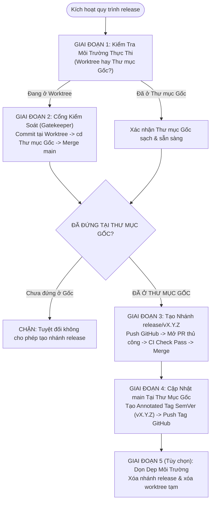

# QT-MES Git Release & Worktree-to-Main Pipeline (`qt-mes-git-release`)

## Tổng Quan

Skill này là **chuẩn hóa duy nhất** cho toàn bộ chu trình phát hành mã nguồn của hệ thống **DYNAMO MES**. Chu trình tích hợp liền mạch từ việc phát hiện môi trường làm việc cục bộ (Git Worktree vs. Thư mục Gốc), cổng kiểm soát an toàn (Gatekeeper), tạo nhánh phát hành chuẩn SemVer, mở Pull Request kiểm tra CI trên GitHub, cho đến việc đánh dấu Tag chính thức và dọn dẹp môi trường.



---

## Cơ Chế Kích Hoạt (Triggers)

Kích hoạt skill này khi người dùng gửi các câu lệnh hoặc cụm từ:
- `qt-mes-git-release` hoặc `/qt-mes-git-release`
- `qt-mes-worktree-merg2main` hoặc `/qt-mes-worktree-merg2main`
- *"hãy chạy release code"*, *"chạy quy trình release"*
- *"kéo worktree về main"*, *"merge worktree vào main"*, *"đưa mã nguồn từ worktree về thư mục gốc"*
- *"commit đẩy lên github"*, *"đẩy nhánh lên GitHub"*, *"mở pull request"*
- *"đánh dấu tag semver"*, *"cập nhật main và tag phiên bản"*

---

## Chi Tiết Quy Trình 5 Giai Đoạn

### GIAI ĐOẠN 1: Kiểm Tra Môi Trường Thực Thi (Worktree vs. Thư Mục Gốc)

Agent chủ động khảo sát môi trường hiện tại bằng các lệnh ngầm:
```powershell
git worktree list
git branch --show-current
git status --short
```

#### Quy tắc nhận diện:
1. **Thư mục Gốc (Main Repo)**: Luôn là **dòng đầu tiên** trong kết quả của `git worktree list` (thường gắn với nhánh `[main]`, ví dụ: `D:/NTT-2025/KAIZEN/m.Clone-github (internet)/liable-reyla-afric`).
2. **Git Worktree**: Bất kỳ thư mục nào từ dòng thứ 2 trở đi trong `git worktree list` (ví dụ: `C:/Users/USER01/.../dynamo_mes_i18n_audit`).

---

### GIAI ĐOẠN 2: Cổng Kiểm Soát (Gatekeeper) & Merge về Thư Mục Gốc

> [!CAUTION]
> **NGUYÊN TẮC BẤT BIẾN CỐT LÕI (GATEKEEPER INVARIANT)**:
> TUYỆT ĐỐI CẤM tạo nhánh phát hành (`release/vX.Y.Z`) hoặc đẩy thẻ Tag trực tiếp từ bên trong thư mục Worktree.
> **Chỉ khi nào phiên làm việc đã xác nhận đứng tại Thư mục Gốc (`main`) thì mới được phép sang Giai đoạn 3.**

#### Trường hợp A: Đang ở Worktree tạm thời
1. **Commit tại Worktree**: Nếu còn tệp thay đổi uncommitted, stage và commit ngay tại worktree:
   ```powershell
   git add .
   git commit -m "feat/fix: <mô tả ngắn gọn công việc trên worktree>"
   ```
2. **Hỏi xác nhận đường dẫn Thư mục Gốc**:
   - Sử dụng `ask_question` (hoặc đối chiếu xác nhận): *"Hệ thống phát hiện Thư mục Gốc là: `[Đường_Dẫn_Gốc]`. Bạn có đồng ý chuyển về đây để merge không?"*
3. **Chuyển về Thư mục Gốc và Merge vào `main`**:
   Cung cấp khối lệnh hoặc One-liner chuyển thư mục an toàn:
   ```powershell
   cd "<ĐƯỜNG_DẪN_THƯ_MỤC_GỐC>"
   git checkout main
   git pull origin main
   git merge <tên_nhánh_worktree> -m "merge: <tên_nhánh_worktree> into main"
   ```
4. **Kiểm tra Gatekeeper**: Xác nhận vị trí hiện tại đã là Thư mục Gốc $\rightarrow$ Cho phép chuyển sang Giai đoạn 3.

#### Trường hợp B: Đã ở Thư mục Gốc từ đầu
- Kiểm tra `git status`, đảm bảo nhánh `main` đã `git pull origin main` mới nhất $\rightarrow$ Chuyển thẳng sang Giai đoạn 3.

---

### GIAI ĐOẠN 3: Tạo Nhánh Release, Mở PR Thủ Công & Kiểm Tra CI trên GitHub UI

Sau khi đã đứng chắc chắn tại **Thư mục Gốc**:

#### 1. Thống nhất số hiệu phiên bản SemVer 2.0.0
- Tra cứu danh sách tag hiện có: `git tag -l`
- Gợi ý phiên bản kế tiếp theo quy tắc SemVer (`v<MAJOR>.<MINOR>.<PATCH>`):
  - Ví dụ: bản trước là `v4.4.0` $\rightarrow$ bản mới chứa tính năng/refactor lớn là `v4.5.0` (hoặc bản vá là `v4.4.1`).

#### 2. Tạo nhánh phát hành và đẩy lên GitHub
```powershell
# Tạo nhánh phát hành chuẩn SemVer tại Thư mục Gốc
git checkout -b release/vX.Y.Z

# Đẩy nhánh lên GitHub
git push -u origin release/vX.Y.Z
```

#### 3. Mở Pull Request & Kiểm tra CI trên GitHub UI
Agent soạn sẵn mẫu Tiêu đề và Mô tả chi tiết (Description) cho người dùng:
- **Tiêu đề PR**: `Release vX.Y.Z: <Tóm tắt cải tiến chính>`
- **Description mẫu (Markdown)**:
  ```markdown
  ### 🚀 Chi tiết phát hành vX.Y.Z:
  - **Tính năng & Nghiệp vụ**: <Chi tiết các tính năng mới/chuyển ngữ/giao diện>
  - **Sửa lỗi & Ổn định**: <Chi tiết các bugfix thời gian chạy>
  - **Bảo toàn kiểm thử & Chuẩn hóa**: 100% tests PASS, Parity đối xứng 0 diffs.
  ```

#### 4. Thao tác người dùng trên GitHub:
1. Nhấp nút xanh **Compare & pull request** cho nhánh `release/vX.Y.Z` vào `main`.
2. Dán nội dung Description ở trên vào ô mô tả.
3. Chờ toàn bộ kiểm tra tự động (**Checks**: Vite build, Vitest, Preview deployment) đạt trạng thái xanh ✅ **All checks have passed**.
4. Nhấp **Merge pull request** $\rightarrow$ **Confirm merge**.

---

### GIAI ĐOẠN 4: Cập Nhật `main` Tại Thư Mục Gốc & Đánh Dấu Tag SemVer Chính Thức

Sau khi PR đã được merge thành công trên GitHub, người dùng quay lại terminal tại **Thư mục Gốc** và chạy khối lệnh:

```powershell
# 1. Chuyển về nhánh main
git checkout main

# 2. Kéo toàn bộ mã nguồn vừa merge trên GitHub về local
git pull origin main

# 3. Tạo Annotated Tag chính thức
git tag -a vX.Y.Z -m "Release vX.Y.Z: <Mô tả tóm tắt phiên bản>"

# 4. Đẩy thẻ Tag lên GitHub Releases
git push origin vX.Y.Z

# 5. Xác minh Tag đã được tạo thành công
git tag -l -n1 vX.Y.Z
```

---

### GIAI ĐOẠN 5: Dọn Dẹp Nhánh Release & Worktree Tạm (Tùy Chọn)

Sau khi phiên bản `vX.Y.Z` đã được phát hành và tag thành công, cung cấp lệnh dọn dẹp môi trường sạch sẽ:

```powershell
# Xóa nhánh release cục bộ và trên remote GitHub
git branch -d release/vX.Y.Z
git push origin --delete release/vX.Y.Z

# Nếu ban đầu bắt đầu từ một Worktree tạm thời, tiến hành xóa worktree và nhánh worktree đó:
git worktree remove "<đường_dẫn_worktree_tạm>"
git branch -d <tên_nhánh_worktree>
```

---

## Nguyên Tắc Vàng An Toàn (Invariants)

1. **Gatekeeping**: Luôn từ chối tạo nhánh `release/` nếu chưa ở Thư mục Gốc.
2. **Bảo toàn Lovable.dev**: Tuyệt đối KHÔNG sử dụng `git push --force` (`-f`) hoặc `git rebase` đối với bất kỳ commit nào đã đẩy lên GitHub.
3. **Mô tả tường minh**: Luôn soạn sẵn tiêu đề và nội dung description đầy đủ các tiêu chuẩn kỹ thuật để người dùng chỉ cần copy dán vào GitHub PR.
