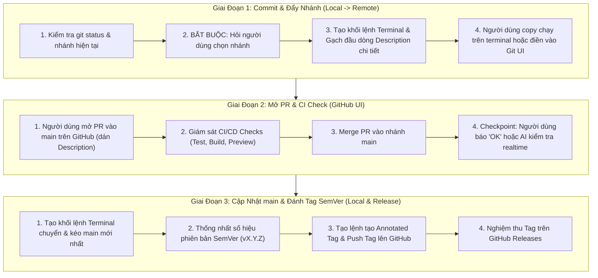

# QT-MES Git Release & SemVer Workflow (Quy Trình Phát Hành Mã Nguồn 3 Giai Đoạn)

## Tổng Quan

Skill này quy định quy trình chuẩn hóa gồm 3 giai đoạn để commit, đồng bộ nhánh, mở Pull Request kiểm tra CI trên GitHub và phát hành phiên bản chính thức theo chuẩn Quốc tế (Semantic Versioning - SemVer) cho hệ thống **DYNAMO MES**.

Điểm cốt lõi của quy trình:
1. **Linh hoạt và trao quyền kiểm soát**: Cung cấp khối lệnh Terminal (PowerShell / Git CLI) rõ ràng để người dùng copy-paste thực thi chủ động.
2. **Hỏi xác nhận nhánh ở Giai đoạn 1**: Không tự ý giả định nhánh mà phải hỏi người dùng chọn nhánh hiện tại hay nhánh mới.
3. **Mô tả chi tiết (Description Bullet Points)**: Cung cấp đầy đủ các gạch đầu dòng tóm tắt nội dung thay đổi để người dùng điền vào ô *"Add a description"* (trên Git UI / GitHub PR) hoặc chạy commit đa dòng qua terminal.
4. **Bảo toàn kết nối Lovable.dev**: Tuyệt đối không force-push (`git push -f`) hoặc viết đè lịch sử git đã đẩy lên remote.
5. **Nghiệm thu CI trên GitHub**: Người dùng chủ động kiểm tra CI/CD trên giao diện GitHub trước khi chốt merge vào `main`.

---

## Cơ Chế Kích Hoạt (Triggers)

Kích hoạt skill này khi người dùng gửi các câu lệnh hoặc yêu cầu tương tự:
- *"qt-mes-git-release"* hoặc *"/qt-mes-git-release"*
- *"hãy chạy release code"*
- *"hãy đẩy lên github"*
- *"hãy commit đẩy lên github"*
- *"hãy commit và đẩy nhánh lên GitHub"*
- *"chạy quy trình release"*
- *"tạo lệnh commit và push nhánh"*
- *"cập nhật main và đánh dấu tag semver"*

---

## Chi Tiết Quy Trình 3 Giai Đoạn



---

### GIAI ĐOẠN 1: Commit & Đẩy Nhánh Lên GitHub

#### Bước 1.1: Khảo sát hiện trạng & Xác nhận nhánh (BẮT BUỘC)
Trước khi đưa ra bất kỳ khối lệnh commit/push nào, Agent phải:
1. Chạy lệnh ngầm `git status` và `git branch --show-current` để nắm thông tin.
2. **Hỏi người dùng câu hỏi xác nhận**:
   - Nhánh hiện tại là `<tên_nhánh_hiện_tại>`.
   - Hỏi người dùng: *"Bạn muốn tiếp tục commit và đẩy lên nhánh hiện tại (`<tên_nhánh>`) hay muốn tạo/chỉ định một tên nhánh cụ thể nào khác?"*

#### Bước 1.2: Sinh khối lệnh Terminal và Gạch đầu dòng Description chi tiết
Sau khi người dùng đã chốt tên nhánh (`TARGET_BRANCH`), Agent thực hiện:
1. **Soạn thảo danh sách gạch đầu dòng chi tiết (Commit Description / Body)** phục vụ việc điền vào mục *"Add a description"* (trên VSCode Source Control, GitHub Desktop, hoặc Description của PR trên GitHub).
2. **Cung cấp 2 lựa chọn thực thi**:
   - **Lựa chọn 1 (Khuyên dùng trong Terminal PowerShell)**: Dùng lệnh commit đa dòng (`-m` lặp lại) chứa sẵn toàn bộ mô tả chi tiết.
   - **Lựa chọn 2 (Đơn giản)**: Dùng dòng commit ngắn gọn kèm block text description riêng biệt để người dùng tùy biến dán vào giao diện UI.

##### Mẫu khối lệnh Terminal đầy đủ kèm Description chi tiết:

```powershell
# 1. Kiểm tra lại trạng thái tệp thay đổi
git status

# 2. Stage các tệp thay đổi cần thiết (tránh commit nhầm file môi trường bí mật)
git add .

# 3. Commit kèm tiêu đề và danh sách gạch đầu dòng mô tả chi tiết:
git commit -m "feat: <tiêu đề ngắn gọn theo chuẩn Conventional Commits>" `
           -m "- <Gạch đầu dòng 1: Cải tiến tính năng / nghiệp vụ>" `
           -m "- <Gạch đầu dòng 2: Cấu hình hệ thống & hạ tầng server>" `
           -m "- <Gạch đầu dòng 3: Bổ sung kế hoạch plan & chuẩn hóa quy trình>" `
           -m "- <Gạch đầu dòng 4: Cập nhật bộ kiểm thử unit tests>"

# 4. Đẩy an toàn lên GitHub (KHÔNG dùng --force)
git push -u origin <TARGET_BRANCH>
```

##### Mẫu nội dung Description dự phòng để Copy dán vào ô "Add a description" trên Git UI / GitHub PR:
```markdown
- **Tính năng & Nghiệp vụ**: <Mô tả chi tiết>
- **Hạ tầng & Cấu hình**: <Mô tả chi tiết>
- **Tài liệu & Kế hoạch**: <Mô tả chi tiết>
- **Kiểm chuẩn & Unit tests**: <Mô tả chi tiết>
```

---

### GIAI ĐOẠN 2: Mở Pull Request & Kiểm Tra CI Tự Động

Giai đoạn này do **Người dùng chủ động thực hiện trên GitHub UI**:
1. Truy cập kho lưu trữ GitHub của dự án.
2. Màn hình sẽ hiện gợi ý *"Compare & pull request"* cho nhánh vừa đẩy -> Bấm mở PR vào nhánh `main`.
3. Dán các gạch đầu dòng Description ở Giai đoạn 1 vào phần mô tả PR.
4. Kiểm tra mục **Checks**:
   - Đảm bảo các automated tests, Vite build, hoặc Vercel deployment preview đạt trạng thái ✅ **All checks have passed**.
5. Chọn **Merge pull request** (hoặc *Rebase and merge* tùy quy ước dự án) -> **Confirm merge**.

#### Điểm kiểm tra (Checkpoint):
- Người dùng gửi thông báo trong chat (ví dụ: *"Đã merge xong PR"* hoặc *"OK xong"*).
- **Hoặc** người dùng yêu cầu Agent kiểm tra thời gian thực (realtime) qua GitHub CLI / git:
  ```powershell
  git fetch origin main
  git log origin/main -n 3 --oneline
  ```

---

### GIAI ĐOẠN 3: Cập Nhật main Tại Local & Đánh Dấu Tag Phiên Bản Quốc Tế (SemVer)

Sau khi Giai đoạn 2 đã được xác nhận hoàn tất, Agent tiếp tục sinh khối lệnh Terminal để người dùng copy-paste thực thi:

#### Bước 3.1: Xác định phiên bản theo chuẩn SemVer 2.0.0
- Quy ước: `v<MAJOR>.<MINOR>.<PATCH>`
  - `MAJOR`: Thay đổi lớn phá vỡ tương thích ngược (breaking changes).
  - `MINOR`: Bổ sung tính năng mới, tương thích ngược (features).
  - `PATCH`: Vá lỗi nhỏ, refactor hoặc tài liệu hóa (fixes/docs).
- Gợi ý tag kế tiếp dựa trên `git tag -l` và commit history.

#### Bước 3.2: Sinh khối lệnh Terminal cập nhật main & tạo Tag
Cung cấp khối lệnh copy-paste:

```powershell
# 1. Chuyển về nhánh main cục bộ
git checkout main

# 2. Kéo toàn bộ mã nguồn vừa merge trên GitHub về local
git pull origin main

# 3. Xác minh commit mới nhất trên nhánh main
git log -1 --oneline

# 4. Tạo Annotated Tag có chú thích theo chuẩn SemVer
git tag -a v1.0.0 -m "Release v1.0.0: <Tóm tắt các tính năng/cải tiến nổi bật>"

# 5. Đẩy thẻ Tag lên GitHub
git push origin v1.0.0

# 6. Kiểm tra lại danh sách tag cục bộ
git tag -l -n1
```

---

## Các Lưu Ý Trọng Yếu & An Toàn

1. **Quy tắc vàng Lovable.dev**:
   - Tuyệt đối KHÔNG chạy hoặc khuyến nghị `git push --force`, `git push -f`, hoặc `git rebase -i` trên các commit đã đẩy lên GitHub.
2. **Kiểm tra tệp nhạy cảm**:
   - Luôn nhắc nhở hoặc kiểm tra file `.gitignore` không để lọt tệp `.env`, `.env.local`, file chứa mật khẩu/token vào commit.
3. **Định dạng Terminal**:
   - Ưu tiên định dạng khối lệnh chạy tương thích tốt trên PowerShell của Windows và Bash Terminal.
