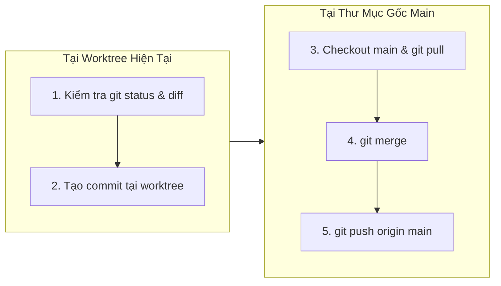

# QT-MES Worktree Merge to Main Workflow (`qt-mes-worktree-merg2main`)

## Tổng Quan

Skill này chuẩn hóa quy trình **2 bước** nhằm đưa toàn bộ thay đổi mã nguồn từ một **Git Worktree đang làm việc** về **thư mục mã nguồn chính (Main Repository)**, tiến hành `merge` an toàn vào nhánh `main` và đẩy (`push`) lên GitHub.



---

## Cơ Chế Kích Hoạt (Triggers)

Kích hoạt skill này khi người dùng yêu cầu:
- *"qt-mes-worktree-merg2main"* hoặc *"/qt-mes-worktree-merg2main"*
- *"kéo worktree này về merge vào mã nguồn main"*
- *"merge worktree vào main"*
- *"đồng bộ worktree về thư mục chính sau đó commit lên github"*
- *"đưa mã nguồn từ worktree về main"*
- *"kéo nhánh worktree về main và push"*

---

## Quy Trình Thực Thi Chuẩn Hóa

### Bước 1: Nhận diện môi trường & Xác nhận đường dẫn Thư mục chính

1. **Kiểm tra trạng thái worktree hiện tại**:
   - Nhánh hiện tại: `git branch --show-current`
   - File thay đổi: `git status --short`
2. **Tự động nhận diện đường dẫn Thư mục chính (Main Repo)**:
   - Chạy lệnh: `git worktree list`
   - Dòng đầu tiên (thường trỏ tới nhánh `[main]`) chính là thư mục mã nguồn chính (ví dụ: `D:/NTT-2025/KAIZEN/m.Clone-github (internet)/liable-reyla-afric`).
3. **BẮT BUỘC Hỏi lại người dùng để nạp thêm cho chính xác**:
   - Sử dụng công cụ `ask_question` (hoặc thông báo hỏi rõ ràng) để người dùng xác nhận đường dẫn thư mục chính:
     > *"Hệ thống tự động phát hiện thư mục gốc main là: `[Đường_Dẫn_Tự_Động]`. Bạn có muốn dùng đường dẫn này hay chỉ định đường dẫn khác?"*
   - Chờ người dùng xác nhận hoặc cung cấp đường dẫn mới trước khi sinh lệnh.

---

### Bước 2: Tóm tắt nội dung thay đổi (Commit Description)

Trích xuất danh sách 3-5 gạch đầu dòng tóm tắt các tính năng / bugfix vừa thực hiện trên worktree để làm nội dung commit message chuẩn Conventional Commits (ví dụ: `feat(...)`, `fix(...)`, `refactor(...)`).

---

### Bước 3: Sinh lệnh One-liner an toàn (Chạy 1 lần từ Worktree)

Cung cấp cho người dùng một khối lệnh One-liner duy nhất kết hợp toán tử `;` (hoặc `&&` trên PowerShell 7+) để người dùng chỉ cần copy và paste chạy 1 lần ngay từ terminal của worktree:

```powershell
# [ONE-LINER] Commit tại worktree -> Chuyển về thư mục main -> Pull -> Merge -> Push GitHub
git add . ; git commit -m "<commit_message>" ; cd "<main_repo_path>" ; git checkout main ; git pull origin main ; git merge <branch_name> -m "merge: <branch_name> into main" ; git push origin main
```

*Trong đó:*
- `<commit_message>`: Thông điệp commit ngắn gọn, rõ ràng theo ngữ cảnh công việc.
- `<main_repo_path>`: Đường dẫn thư mục chính đã được người dùng xác nhận (dạng Windows chuẩn có dấu ngoặc kép `"..."`).
- `<branch_name>`: Tên nhánh của worktree hiện tại.

---

### Bước 4: Hướng dẫn Dọn dẹp Worktree (Tùy chọn)

Sau khi merge và push thành công lên GitHub, cung cấp lệnh tùy chọn nếu người dùng muốn dọn dẹp worktree hiện tại:
```powershell
# Chạy tại thư mục main để xóa worktree đã hoàn tất
git worktree remove "<worktree_path>"
# Xóa nhánh local nếu không còn sử dụng
git branch -d <branch_name>
```

---

## Nguyên Tắc An Toàn (Invariants)

1. **Hỏi xác nhận thư mục**: Tuyệt đối không tự ý dùng đường dẫn giả định mà phải đối chiếu qua `git worktree list` và hỏi lại người dùng.
2. **Không làm mất dữ liệu uncommitted**: Luôn chạy `git add .` và `git commit` trên worktree trước khi thực hiện chuyển thư mục và merge.
3. **Bảo toàn lịch sử Lovable**: Không dùng `git push -f`, giữ nguyên lịch sử git chuẩn mực.
