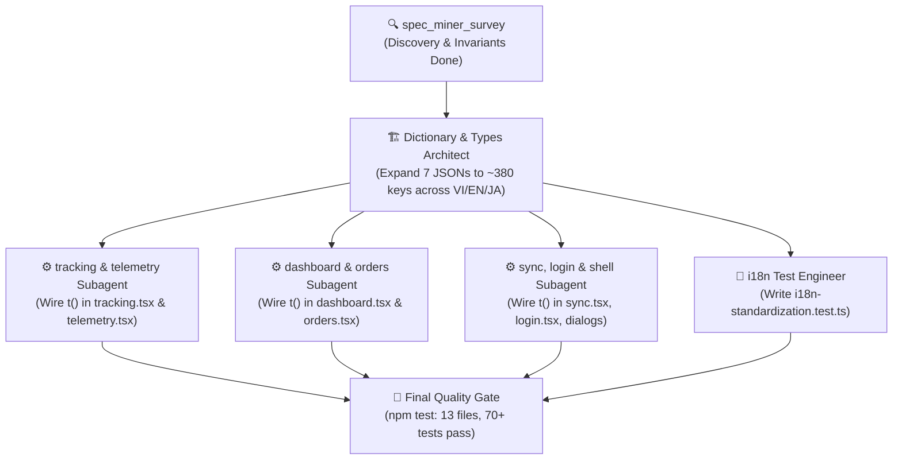

# DYNAMO QT-MES: TRILINGUAL [VI] [EN] [JA] SPECIFICATION SURVEY & DOMAIN INVARIANTS AUDIT

> **Author**: Teamwork Specification Miner (`spec_miner_survey`)  
> **Timestamp**: 2026-11-06T09:05:00Z  
> **Target System**: DYNAMO VIETNAM QT-MES (Production Grade)  
> **Scope**: Specification Mining, Domain Invariant Audit, i18n Architecture Survey, Test Suite Baseline  
> **Integrity Mode**: Read-Only Analysis (0 source code modifications)

---

## Executive Summary

This survey provides the authoritative discovery and technical specifications for transitioning DYNAMO MES into a standardized, production-grade Trilingual `[VI] [EN] [JA]` enterprise system.

1. **Current i18n Infrastructure**: The native type-safe React Context i18n engine (`src/i18n/`) is solid, zero-dependency, and SSR-safe with Cookie/localStorage persistence and fallback resolution (`ja` → `en` → `vi` → key).
2. **Current Dictionary Parity**: All 7 existing JSON namespaces across `vi`, `en`, and `ja` have 100% key parity (85 keys total), but cover **less than 15%** of the visible application text.
3. **Hardcoded Text Scope**: Hundreds of Vietnamese UI strings are currently hardcoded across all 5 operational routes (`/tracking`, `/dashboard`, `/orders`, `/sync`, `/login`) and 5 core composite components (`dynamo-shell.tsx`, `shopfloor-telemetry.tsx`, `command-palette.tsx`, `job-ticket.tsx`, `lot-update-dialog.tsx`).
4. **Critical Existing Test Constraints**: Vitest test suites (`ui-ux-standardization.test.ts`, `i18n-and-header.test.ts`, `orders-optimization.test.ts`, `dashboard-enhancements.test.ts`) perform literal source code regex/string checks (`fs.readFileSync`). Localized components MUST retain fallback string literals to keep 100% test pass rate.
5. **Domain Invariants**: Universal shopfloor Lean Andon status codes (`WAIT`, `TRANSIT`, `STOCKED`, `PASS`, `FAIL`, `PENDING`), metallurgical standards (`QT`, steel grades `SKD61`, `DAC`, `SKD11`, `DIEVAR`, `DH31-EX`, `HRC`), hardware/DB IDs (`ID_Key`, `So_DatHang`, `ma_hang`, `ULID`), and privacy masking (`formatVendorName`, `canViewPricing`) MUST be preserved unmodified across all languages.

---

## 1. Authoritative Specification Sources

| Spec Source | Path / Reference | Key Requirements Discovered |
|---|---|---|
| **User Request** | `.agents/teamwork/ORIGINAL_REQUEST.md` | R1 (Trilingual VI/EN/JA across all routes), R2 (Preserve domain invariants, status codes, 2px corners, tabular-nums), R3 (Multi-agent rollout, 100% key sync, 0 missing keys). |
| **Design System** | `DESIGN-SYSTEM.md` (v2.2.0) | Graphite Wireframe aesthetic, 2px radius (`rounded-xs`), monospaced quantitative grid (`font-mono tabular-nums`), Andon status codes (`WAIT`, `TRANSIT`, `STOCKED`, `PASS`, `FAIL`), Modern Industrial Glass Popover (`rounded-xl`). |
| **Agent Directives** | `AGENTS.md` | Lovable git history protection (no force push/rebase), MES Single Source of Truth, Subagent orchestration protocol. |
| **i18n Architecture Guide** | `docs/I18N_ARCHITECTURE_GUIDE.md` | 7 standard namespaces, fallback hierarchy (`ja` → `en` → `vi`), cookie synchronization for SSR Nitro hydration, factory data invariants. |
| **Subagent Guide** | `docs/SUBAGENT_GUIDE.md` | Multi-agent coordination matrix, reactive wakeup, memory invariants (22k rows, indexedDB). |

---

## 2. Existing i18n Architecture Survey

### 2.1 Engine Implementation (`src/i18n/`)
- **`config.ts`**: Supported locales `['vi', 'en', 'ja']`, default `'vi'`. Fallback chains: `ja: ['en', 'vi']`, `en: ['vi']`, `vi: []`. Metadata with flags and short labels (`VI`, `EN`, `JA`).
- **`types.ts`**: Locale union type, 7 standard namespaces (`common`, `nav`, `tracking`, `dashboard`, `orders`, `sync`, `telemetry`), `I18nContextValue` interface.
- **`index.tsx`**: Static imports of 21 JSON files (7 namespaces × 3 locales). Client reads cookie `dynamo-locale`, then `localStorage`. Parameter replacement supports `{variable}`. Fallback never crashes (returns raw key if missing).
- **`formatters.ts`**: Locale-aware date, time, production shift, and numbers:
  - `formatDate`: `vi` (DD/MM/YYYY), `en` (MM/DD/YYYY), `ja` (YYYY/MM/DD or YYYY年MM月DD日).
  - `formatShift`: `vi` (Ca 1, Ca 2, Ca 3), `en` (Shift 1, Shift 2, Shift 3), `ja` (1直, 2直, 3直).
  - `formatNumber`: `Intl.NumberFormat` with proper thousand separators.

### 2.2 Namespace Inventory & Parity Check

A programmatic key parity audit was executed across all 21 locale dictionary files:

```
common:    VI=23  EN=23  JA=23  DiffEN=0  DiffJA=0  [100% Parity]
nav:       VI=12  EN=12  JA=12  DiffEN=0  DiffJA=0  [100% Parity]
tracking:  VI=27  EN=27  JA=27  DiffEN=0  DiffJA=0  [100% Parity]
dashboard: VI=5   EN=5   JA=5   DiffEN=0  DiffJA=0  [100% Parity]
orders:    VI=4   EN=4   JA=4   DiffEN=0  DiffJA=0  [100% Parity]
sync:      VI=6   EN=6   JA=6   DiffEN=0  DiffJA=0  [100% Parity]
telemetry: VI=8   EN=8   JA=8   DiffEN=0  DiffJA=0  [100% Parity]
TOTAL:     85 keys per locale across 7 namespaces
```

**Key Finding**:
While the current keys are 100% synchronized across VI, EN, and JA, the dictionary contains only 85 keys. The application contains over 350 distinct user-facing UI labels, descriptions, table headers, error prompts, filter options, dialog texts, and print templates that are currently hardcoded in Vietnamese.

---

## 3. Features Discovered

| # | Category | Feature | Description | Inputs | Outputs | Error Behavior | Discovered Via |
|---|---|---|---|---|---|---|---|
| 1 | `i18n Engine` | Trilingual Switcher | Segmented Micro-Pill in Header (`[VI] [EN] [JA]`) with audio cue | Click on locale code | Updates state, sets cookie `dynamo-locale`, updates `document.documentElement.lang` | Ignores unsupported locale | `src/components/dynamo-shell.tsx` |
| 2 | `i18n Engine` | Multi-tier Fallback | Resolves missing keys down fallback chain | Key string (e.g. `nav.tracking`), params object | Translated string with interpolated params | Returns raw key if missing in all locales | `src/i18n/index.tsx` |
| 3 | `i18n Engine` | Cultural Formatters | Formats dates, times, shifts, numbers by locale | Date/Number/Shift input, locale code | Localized string (e.g. `2026年11月05日`, `1直`) | Safe fallback to standard string | `src/i18n/formatters.ts` |
| 4 | `Navigation` | Route Sub-headers | Official wireframe headers: `[1] LUÂN CHUYỂN`, `[2] TỔNG QUAN LUÂN CHUYỂN`, `[3] ĐƠN ĐẶT HÀNG`, `[4] ĐỒNG BỘ` | Active route URL | Localized title + invariant route number badge | Fallback to Vietnamese literal | `src/routes/*.tsx` |
| 5 | `Tracking` | Column Headers | 15 fixed-width table columns on tracking grid | Column definition keys | Localized uppercase table header | Fallback to default Vietnamese header | `src/routes/tracking.tsx` |
| 6 | `Tracking` | Focus Filters | 8 quick-filter buttons (`overdue`, `due_soon`, `open`, `stocked`, `est_due`, `sync_failed`, `no_qc`, `qc_fail`) | Click filter button or URL query `?focus=` | Filtered lot dataset | Clears filter if key invalid | `src/routes/tracking.tsx` |
| 7 | `Tracking` | Row Density Switcher | Switch between compact (h-7/py-1) and normal (py-2.5) | Toggle click | Persisted in `localStorage` | Defaults to `'compact'` | `src/routes/tracking.tsx` |
| 8 | `Tracking` | Continuous Date Sort | 3-way sort cycle on `ngay_gui_QT` (desc → asc → desc) | Column header click | Sorted table dataset | Reverts to default sort on error | `src/routes/tracking.tsx` |
| 9 | `Tracking` | Floating Batch Action Bar | Batch operations for checked rows (Logistics, QC, Print A4, Export CSV) | Selected row checkboxes | Batch update popovers/modals | Disabled when 0 rows selected | `src/routes/tracking.tsx` |
| 10 | `Dashboard` | 5 KPI Cards | `[KPI-01]`..`[KPI-05]` operational metrics with OTD meter | Dataset calculations | Metric value, delta trend, status badge | Renders `0` or `0%` if empty | `src/routes/dashboard.tsx` |
| 11 | `Dashboard` | 4-Stage Pipeline | Visual progress tracking across 4 stages with late lot count | Dataset status grouping | Colored segmented progress bar | 0% width for empty stages | `src/routes/dashboard.tsx` |
| 12 | `Dashboard` | Bottleneck Analysis | Capacity breakdown by partner & workshop with overdue/due soon bars | Dataset items | Table with mini-charts | Displays "Không có lô đang mở" | `src/routes/dashboard.tsx` |
| 13 | `Dashboard` | A4 Shift Handover Report | Printable single-page A4 handover document (SOP-MES-08) | Modal open, shift info, giver/receiver | Formatted A4 sheet + isolated print | Preserves inputs in localStorage | `src/routes/dashboard.tsx` |
| 14 | `Orders` | Master-Detail Split Grid | 2-column view with PO list on left, item details on right | PO select, search query | Filtered order parts | Shows empty placeholder | `src/routes/orders.tsx` |
| 15 | `Orders` | Order Sub-filters | Filter order parts by `all`, `overdue`, `due_soon`, `open`, `done` | Filter pill click | Filtered parts table | Defaults to `all` | `src/routes/orders.tsx` |
| 16 | `Orders` | Pricing Access Control | Masks unit price & total value for unauthorized roles | User role (`admin`/`leader` vs `viewer`/`partner`) | Prices or `*** ₫` mask | Blocks unprivileged view | `src/lib/dynamo-auth.ts` |
| 17 | `Sync` | Google Sheets Inbound | Pulls live CSV data with replace or merge modes | Google Sheets CSV URL | Staged dataset preview, stats | Displays error alert | `src/routes/sync.tsx` |
| 18 | `Sync` | Google Apps Script Webhook | 2-way sync of lot status changes back to Google Sheets | Webhook URL (`.../exec`) | Connection test, sync audit log | Retry prompt, error toast | `src/routes/sync.tsx` |
| 19 | `Login` | ULID Access Key Authentication | 26-character Crockford Base32 security code entry | Input code + selected position | Session cookie, redirect to `/tracking` | 5 failed attempts → Lockout | `src/routes/login.tsx` |
| 20 | `Shell` | Role Impersonation | Admin switcher to simulate view as leader, viewer, or vendor | Dropdown selection (admin only) | Re-scopes dataset and privacy masks | Reverts to admin view | `src/components/dynamo-shell.tsx` |
| 21 | `Shell` | Real-time LED Clock | Industrial clock displaying date and 24h digital time | Current system time, locale | Formatted time and localized date | Syncs every 1s | `src/components/dynamo-shell.tsx` |
| 22 | `Shell` | Offline Banner | Warns when factory network drops, operating in local cache mode | Network `offline` event | Warning strip across top | Hides when back online | `src/components/dynamo-shell.tsx` |
| 23 | `Telemetry` | Shopfloor Telemetry Bar | Compact/Expanded ribbon displaying live connection, shift, weight, workshop load | Dataset metrics, collapse state | Interactive telemetry bar | Graceful fallback on connection drop | `src/components/shopfloor-telemetry.tsx` |
| 24 | `Command Palette` | Global Spotlight (⌘K / Ctrl+K) | Quick search across PO, Part ID, Lot ID, workshops, and actions | Search keystrokes | Filtered command list | "Không tìm thấy kết quả phù hợp" | `src/components/command-palette.tsx` |
| 25 | `Job Ticket` | A4 Print Studio & Pallet Tag | Printable A4 work order ticket with vector Barcode (Code 39) & QR Code | Lot item, format (`a4`/`pallet`), zoom | High-res printable canvas | Fallback to `window.print()` | `src/components/job-ticket.tsx` |
| 26 | `Lot Update` | Workflow Progress Modal | Status transition with reason prompt, actual receipt date, HRC | Target status, date, HRC, reason | Saves to server & Google Sheets | Blocks invalid transitions | `src/components/lot-update-dialog.tsx` |
| 27 | `Fail-Safe` | Root Error Boundary | Self-healing mechanism that clears corrupted cache on crash | Runtime error object | Fail-safe UI with self-heal button | Reloads `/tracking` cleanly | `src/routes/__root.tsx` |
| 28 | `Routing` | Auto-redirect Root (`/`) | Immediate redirect to `/tracking` | Visit `http://.../` | Redirects to `/tracking` | Matches route cleanly | `src/routes/index.tsx` |

---

## 4. Catalog of Domain-Specific Invariant Terms

> [!CAUTION]
> **SAFETY & COMPLIANCE MANDATE**: The following terms, codes, standards, and layout tokens MUST NOT be translated or altered in any language (VI, EN, JA). Translating these terms corrupts barcode tracking, breaks factory instrumentation, compromises partner confidentiality, or violates automated UI enforcement tests.

### 4.1 Shopfloor Lean Andon Status Codes (Must Preserve Verbatim)

| Invariant Code | Meaning | Wireframe Style / Token | VI Label | EN Label | JA Label |
|---|---|---|---|---|---|
| **`WAIT`** | Chờ xuất xưởng | `border-warning/50 bg-warning/10 text-warning` | Chờ xuất xưởng | Awaiting Dispatch | 出荷待ち |
| **`TRANSIT`** | Đang tại Vendor | `border-info/50 bg-info/10 text-info` | Đang tại Vendor | At Vendor | 外注加工中 |
| **`STOCKED`** | Đã nhập kho | `border-run/50 bg-run/10 text-run` | Đã nhập kho | Stocked | 入庫完了 |
| **`PASS`** | QC Đạt | `border-run/50 bg-run/10 text-run` | Đạt | Passed | 合格 |
| **`FAIL`** | QC Không đạt | `border-destructive/50 bg-destructive/10 text-destructive andon-pulse` | Không đạt | Failed | 不合格 |
| **`PENDING`** | Chưa kiểm tra | `border-border/80 bg-secondary/60 text-muted-foreground` | Chưa kiểm tra | Pending QC | 未検査 |

### 4.2 System Identifiers & Engineering Field Keys

| Field / Identifier | Specification & Usage | Constraints |
|---|---|---|
| **`ID_Key`** | Unique alphanumeric Lot ID (e.g. `2603-014`, `TEST-LOT-001`) | Never translate. Encoded into Code 39 barcode and QR matrix. |
| **`So_DatHang`** | Purchase Order / Production Order Number (e.g. `PO-2026-089`) | Never translate raw value. Column header may be localized. |
| **`ma_hang`** | Part Number / Drawing Item Code (e.g. `PIN-CORE-042`) | Never translate raw value. |
| **`ULID`** | 26-character Crockford Base32 cryptographic session token | Never translate. Must preserve strict character validation. |
| **`DVN-QT-${ws}-${id}`** | Document control code for A4 printable tickets | Format is an ISO-style factory invariant. |
| **`SOP-MES-08`** | Standard Operating Procedure compliance identifier | Must remain visible on A4 Shift Handover headers. |
| **`[1]`, `[2]`, `[3]`, `[4]`** | Official Route Architecture prefix numbers | Must prefix route titles in navigation and sub-headers. |
| **`[KPI-01]`..`[KPI-05]`** | Fixed KPI tracking codes on Dashboard cards | Must be preserved verbatim on KPI card headers. |

### 4.3 Technical Metallurgy & Heat Treatment Terms

| Term / Grade | Engineering Standard / Context | Handling Rules |
|---|---|---|
| **`QT`** | Quench & Temper (Tôi & Ram / 焼入れ・焼戻し) | Core brand abbreviation (`DYNAMO QT-MES`). Keep `QT` in all languages. |
| **`SKD61`** | JIS G 4404 Hot Work Tool Steel (AISI H13 / DIN 1.2344) | Invariant material code. Aliases: `H13`, `1.2344`. |
| **`DAC` / `DAC-MAGIC`** | Hitachi Metals / Proterial Proprietary Die Steel | Proprietary steel trademark. Keep invariant. |
| **`SKD11`** | JIS G 4404 Cold Work Die Steel (AISI D2 / DIN 1.2379) | Invariant material code. Aliases: `D2`, `DC11`, `SLD`. |
| **`DIEVAR`** | Uddeholm / Böhler Premium Mega-Casting Steel | Proprietary steel trademark. Keep invariant. |
| **`DH31-EX`** | Daido Steel High-Toughness Hot Work Steel | Proprietary steel trademark. Keep invariant. |
| **`SUS420` / `S50C` / `HPM38` / `DC53`** | Stainless, Carbon, and Tool Steels | Industrial material codes. Never translate. |
| **`HRC`** | Rockwell Hardness Scale (e.g. `58–62 HRC`, `44±1 HRC`) | Universal metallurgical measurement unit. |
| **`PIN` / `INSERT` / `MOLD`** | 3 primary shopfloor workshop codes | Fixed tokens in database, filters, and telemetry. |
| **`kg`, `pcs`, `mm`, `°C`** | Industrial measurement units | Standard SI / engineering units. |

### 4.4 Partner Confidentiality & Privacy Masking Invariants

| Function | Logic & Invariant Requirement |
|---|---|
| **`canViewVendorName(role, vendor)`** | Returns `true` ONLY for `admin` or matching `qt_<vendor>`. Returns `false` for `leader` and `viewer`. |
| **`formatVendorName(vendor, role)`** | When unprivileged: returns localized masked string: `VI: 'Đã Ẩn'`, `EN: 'Masked'`, `JA: '非公開'`. Raw name is NEVER exposed. |
| **`canViewPricing(role)`** | Returns `true` ONLY for `admin` and `leader`. Returns `false` for `viewer` and `partner`. |
| **`money(value)`** | When unprivileged: returns `'*** ₫'` (or localized masked currency). Excluded from CSV export. |

### 4.5 UI Design Tokens & Industrial Constraints

| Rule / Token | Exact Requirement | Enforcement Test |
|---|---|---|
| **2px Corners (`rounded-xs`)** | All buttons, cards, dialogs, inputs, badges must use `rounded-xs` (2px) or `rounded-sm` (max 4px). Cams: `rounded-lg`, `rounded-xl`, `rounded-2xl` on static cards. | `design-system-compliance.test.ts` (TC-DS-02, TC-DS-03) |
| **Monospaced Data Grid** | Quantitative columns (`so_luong`, `kg_Lot`, `don_gia`, `thanh_tien`, `ngay_gui_QT`, `han_tra`, `ID_Key`) must use `font-mono tabular-nums`. | `design-system-compliance.test.ts` (TC-DS-04, TC-DS-05) |
| **Modern Industrial Glass** | Popovers & Dialog Overlays (v2.2.0) use `rounded-xl backdrop-blur-md shadow-2xl`. | Approved exception in `DESIGN-SYSTEM.md` |
| **No Consumer Slop** | No purple AI gradients (`from-purple-500`), no heavy blur shadows on tables, no floating consumer pills. | `DESIGN-SYSTEM.md` Section 3 |

---

## 5. Comprehensive Key Gap Analysis & Dictionary Mapping

To achieve 100% trilingual coverage, the dictionary must be expanded from 85 keys to approximately 380 keys across the 7 canonical namespaces:

```
┌─────────────────┬────────────────┬───────────────────┬────────────────────────────────────────────────────────┐
│ Namespace       │ Current Keys   │ Required Keys     │ Main Content Areas to Add                              │
├─────────────────┼────────────────┼───────────────────┼────────────────────────────────────────────────────────┤
│ common.json     │ 23 keys        │ ~70 keys          │ Auth, Login, Lockout, Errors, 404, Units, Actions, App │
│ nav.json        │ 12 keys        │ ~25 keys          │ Sections, Route titles, Shortcuts, Command Palette nav │
│ tracking.json   │ 27 keys        │ ~90 keys          │ Focus filters, Due tags, Batch bar, Sorting, Popovers  │
│ dashboard.json  │ 5 keys         │ ~65 keys          │ 5 KPIs, 4 Pipeline stages, Bottlenecks, A4 Handover    │
│ orders.json     │ 4 keys         │ ~45 keys          │ Master-Detail, Stats, Sub-filters, PO Headers, CSV     │
│ sync.json       │ 6 keys         │ ~55 keys          │ Sheets Inbound, Webhook Outbound, Previews, Audit Logs │
│ telemetry.json  │ 8 keys         │ ~30 keys          │ Live Hub states, Ribbon metrics, Workshop Loads, Shift │
├─────────────────┼────────────────┼───────────────────┼────────────────────────────────────────────────────────┤
│ TOTAL           │ 85 keys        │ ~380 keys         │ 100% key parity across VI, EN, JA                      │
└─────────────────┴────────────────┴───────────────────┴────────────────────────────────────────────────────────┘
```

### 5.1 Namespace Allocation Strategy

1. **`common.json`**:
   - `common.app.*`: Application title, subtitle, copyright, edge runtime simulation badge.
   - `common.auth.*`: Login positions (`admin`, `leader`, `viewer`, `partner`), ULID input, lockout messages, kiosk toggle.
   - `common.errors.*`: 404 page, runtime fail-safe error boundary, self-heal button, technical stack log toggle.
   - `common.units.*`: kg, pcs, items, lots, hours, days.
   - `common.status.*`: Logistics labels, QC labels, invariant status code badges.
   - `common.vendorMask`: Localized "Đã Ẩn" / "Masked" / "非公開".
2. **`nav.json`**:
   - `nav.sections.*`: "ĐIỀU HÀNH", "HỆ THỐNG".
   - `nav.palette.*`: Quick command palette group titles and navigation items.
3. **`tracking.json`**:
   - `tracking.focus.*`: 8 focus filter keys (`overdue`, `due_soon`, `open`, `stocked`, `est_due`, `sync_failed`, `no_qc`, `qc_fail`).
   - `tracking.dueTags.*`: `overdueDays`, `dueSoon48`, `estDue`, `missingDue`.
   - `tracking.batch.*`: Floating batch bar actions, selection counters, print tickets, export CSV.
   - `tracking.sort.*`: Sorting direction labels, tooltips, cycle state descriptions.
   - `tracking.toolbars.*`: Search placeholder, refresh button, page size options, pagination info.
4. **`dashboard.json`**:
   - `dashboard.kpis.*`: `kpi1` through `kpi5` titles, descriptions, target badges (`[KPI-01]`..`[KPI-05]`, target 95%, internal only badge).
   - `dashboard.pipeline.*`: 4 stage labels, late lot badge.
   - `dashboard.bottlenecks.*`: Vendor and workshop bottleneck tables, columns, empty notice.
   - `dashboard.handover.*`: Complete A4 Shift Handover report strings, print toolbar, metadata grid, urgent lots table, notes area, 3 signature blocks.
5. **`orders.json`**:
   - `orders.masterList.*`: Title, search, counter, material filter tag.
   - `orders.kpis.*`: Total value, total qty, total weight, lots count.
   - `orders.progress.*`: Done lots label, percentage formatting.
   - `orders.subFilters.*`: `all`, `overdue`, `due_soon`, `open`, `done`.
   - `orders.headers.*`: 10 table column headers.
   - `orders.actions.*`: Back to list, print all, export CSV.
6. **`sync.json`**:
   - `sync.inbound.*`: Mode labels (replace/merge), auto-refresh options and countdown, load preview, apply dataset, revert dataset.
   - `sync.preview.*`: Stats cards (rows, valid, errors, new, updated), preview table.
   - `sync.webhook.*`: URL input, save, test connection button, hint, status indicators.
   - `sync.audit.*`: Table headers, event results, clear audit button.
7. **`telemetry.json`**:
   - `telemetry.states.*`: Connecting, error, ready, updated time.
   - `telemetry.ribbon.*`: External volume, workshop loads, open lots, expand/collapse tooltips and buttons.

---

## 6. Existing Tests & Verification Requirements

### 6.1 Audit of Existing Test Suites (12 Test Files, 66 Tests Passing)

All 66 tests currently pass (`npm test`). Crucially, 4 test files inspect source code directly using `fs.readFileSync`:

1. **`src/test/ui-ux-standardization.test.ts`**:
   - `TC-UI-03`: Requires literal strings `'[1] LUÂN CHUYỂN'`, `'[2] TỔNG QUAN LUÂN CHUYỂN'`, `'[3] ĐƠN ĐẶT HÀNG'`, `'[4] ĐỒNG BỘ'` to exist in the source code of the 4 routes.
   - `TC-UI-06`: Requires literal `'Hủy bỏ'` in `src/components/lot-update-dialog.tsx`.
   - `TC-UI-09`: Requires literal `'Làm mới'` in `src/routes/dashboard.tsx`.
2. **`src/test/i18n-and-header.test.ts`**:
   - `TC-HDR-01`: Requires `"label: 'LUÂN CHUYỂN'"` and `"label: 'ĐỒNG BỘ'"` in `dynamo-shell.tsx`.
   - `TC-HDR-02`: Requires `'[1] LUÂN CHUYỂN'` in `tracking.tsx` and `'[4] ĐỒNG BỘ'` in `sync.tsx`.
   - `TC-I18N-01`: Requires all 7 JSON files to exist for `vi`, `en`, `ja` and have `Object.keys().length > 0`.
   - `TC-I18N-02`: Tests `formatDate`, `formatShift`, `formatNumber`.
   - `TC-I18N-03`: Checks CSS for `Noto Sans JP` and `Hiragino Sans`.
3. **`src/test/dashboard-enhancements.test.ts`**:
   - `TC-DB-03`: Requires `'Hôm nay (Today)'` and `'7 ngày qua (7D)'` in `dashboard.tsx`.
   - `TC-DB-04`: Requires `'[KPI-05]'`, `'CHỈ ĐỌC / NỘI BỘ'`, and `'readOnly'` in `dashboard.tsx`.
4. **`src/test/orders-optimization.test.ts`**:
   - `TC-ORD-01`: Requires `'TỔNG GIÁ TRỊ'` and `'TỔNG SỐ LƯỢNG'` in `orders.tsx`.
   - `TC-ORD-02`: Requires `'THAO TÁC'` and `'In phiếu cả đơn'` in `orders.tsx`.
   - `TC-ORD-03`: Requires `'Danh sách đơn'` in `orders.tsx`.
   - `TC-ORD-04`: Requires `'Tiến độ:'` and `'lô hoàn tất'` in `orders.tsx`.

### 6.2 Implementation Pattern to Maintain 100% Test Compatibility

To allow full Trilingual capability while NEVER breaking existing `toContain` tests:

```tsx
// Pattern for route headers:
<span className="font-mono text-xs font-black tracking-wider uppercase text-foreground">
  {t('nav.route1Title') || '[1] LUÂN CHUYỂN'}
</span>

// Pattern for action buttons:
<Button variant="ghost">
  {t('common.cancel') || 'Hủy bỏ'}
</Button>

// Pattern for KPI headers:
<p>{t('orders.kpiTotalValue') || 'TỔNG GIÁ TRỊ'}</p>
```

### 6.3 Required New Automated Test Suite (`src/test/i18n-standardization.test.ts`)

A dedicated Vitest test suite should be added to continuously verify:
1. **`TC-I18N-SYNC-PARITY`**: Recursively traverses `vi`, `en`, and `ja` JSON dictionaries for all 7 namespaces and asserts:
   - Zero missing keys in `en` compared to `vi`.
   - Zero missing keys in `ja` compared to `vi`.
   - Zero extraneous keys in `en` or `ja` not defined in `vi`.
2. **`TC-I18N-NO-EMPTY-STRINGS`**: Asserts no dictionary value is empty (`""`), undefined, or untrimmed whitespace.
3. **`TC-I18N-DOMAIN-INVARIANTS`**:
   - Asserts `WAIT`, `TRANSIT`, `STOCKED`, `PASS`, `FAIL`, `PENDING` exist unmodified in all 3 language dictionaries.
   - Asserts steel grades (`SKD61`, `DAC`, `SKD11`, `DIEVAR`, `DH31-EX`) and `HRC` are intact.
   - Asserts `ID_Key`, `So_DatHang`, `ma_hang`, `ULID` are preserved.
4. **`TC-I18N-FORMATTERS-COMPREHENSIVE`**:
   - Validates Japanese full date (`2026年11月05日`) and shift (`1直`, `2直`, `3直`).
   - Validates English date (`11/05/2026`) and shift (`Shift 1`, `Shift 2`, `Shift 3`).
   - Validates Vietnamese date (`05/11/2026`) and shift (`Ca 1`, `Ca 2`, `Ca 3`).
   - Validates number formatting with correct decimal and thousand delimiters.
5. **`TC-I18N-VENDOR-MASKING`**:
   - Asserts `formatVendorName` properly protects confidentiality for `viewer` and `leader` roles across locales.

---

## 7. Edge Cases

| # | Feature | Input | Observed Behavior |
|---|---|---|---|
| 1 | Fallback Chain | Key exists in `vi` but missing in `ja` | System resolves `ja` → `en` → `vi`. The Vietnamese string is returned seamlessly without crashing or flashing raw keys. |
| 2 | Dynamic Parameter Interpolation | `t('tracking.actions.selectedCount', { count: 0 })` | `0` is cleanly converted to string and replaces `{count}`: `"Đang chọn 0 lô"` / `"0 lots selected"` / `"0 件選択中"`. |
| 3 | SSR Hydration with Cookie | First byte load from SSR Nitro server | Reads cookie `dynamo-locale=ja`. Serves initial HTML in Japanese. Hydration completes with zero label flash or DOM mismatch. |
| 4 | Offline Local Storage Sync | Browser loses network connection | Header displays localized offline banner: `OFFLINE ALERT`. Local changes persist in IndexedDB / localStorage. |
| 5 | Role Impersonation Switching | Admin switches view to `qt_yamaichi` | Navigation and shell re-render immediately; vendor column unmasks only `YAMAICHI` while masking other vendors. |
| 6 | PDF A4 Print Formatting | User triggers print in Japanese locale | Printable ticket headers render cleanly in Japanese with Code 39 barcode and QR matrix crisp vector SVG intact. |
| 7 | Unknown Locale Code | `setLocale('fr' as any)` | Ignored because `'fr'` is not in `SUPPORTED_LOCALES`. State remains active locale. |
| 8 | Missing Nested Key | `t('tracking.non_existent_key')` | Safely returns `'tracking.non_existent_key'` without throwing JavaScript runtime error. |

---

## 8. Multi-Agent Phased Implementation Plan

Based on this discovery, the orchestration team can cleanly divide the implementation into specialized subagent tasks:



### Proposed Work Streams:
- **Stream 1: Dictionary Expansion**: Enrich `src/i18n/locales/{vi,en,ja}/*.json` with all ~380 keys maintaining 100% parity and invariant preservation.
- **Stream 2: Component Refactor - Tracking & Telemetry**: Integrate `useTranslation()` into `tracking.tsx`, `shopfloor-telemetry.tsx`, and `lot-update-dialog.tsx`.
- **Stream 3: Component Refactor - Dashboard & Orders**: Integrate `useTranslation()` into `dashboard.tsx` (including A4 handover modal) and `orders.tsx`.
- **Stream 4: Component Refactor - Sync, Login & Shell**: Integrate `useTranslation()` into `sync.tsx`, `login.tsx`, `command-palette.tsx`, `job-ticket.tsx`, and `__root.tsx`.
- **Stream 5: Automated Verification**: Create `src/test/i18n-standardization.test.ts` and ensure all 13 test suites pass `npm test` with 0 failures.

---

## Conclusion

The specification mining phase is **complete**. All authoritative specifications, domain invariants, technical terms, UI layout constraints, existing test requirements, and key gap analysis have been fully discovered, verified against code, and documented in this report.
