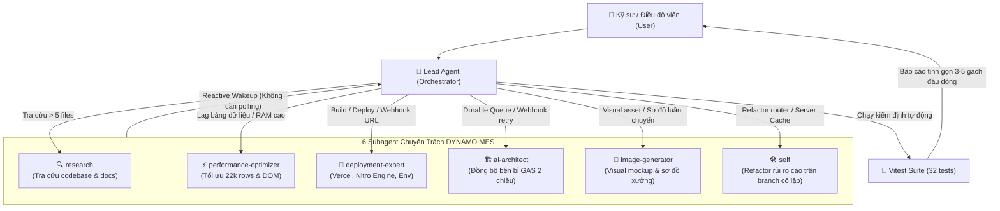

# CẨM NANG VẬN HÀNH 6 SUBAGENT — DYNAMO MES

> **Phiên bản**: v1.0.0  
> **Áp dụng cho**: Hệ thống điều độ luân chuyển nhiệt luyện QT — DYNAMO MES  
> **Môi trường**: Google Antigravity Agentic Platform  
> **Tham chiếu cốt lõi**: [`AGENTS.md`](../AGENTS.md) & [`DESIGN-SYSTEM.md`](../DESIGN-SYSTEM.md)

---

## 1. TỔNG QUAN KIẾN TRÚC ĐA TÁC TỬ (MULTI-AGENT ARCHITECTURE)

Trong môi trường Antigravity, **Lead Agent** đóng vai trò điều phối trung tâm (Orchestrator). Thay vì giải quyết mọi tác vụ trong một context window duy nhất làm tràn bộ nhớ và suy giảm độ chính xác, Lead Agent âm thầm ủy quyền cho **6 Subagent chuyên trách** chạy ngầm (background execution).



### Cơ Chế Phản Hồi Bất Đồng Bộ (Reactive Wakeup)
- Khi Lead Agent khởi tạo một subagent, tác vụ sẽ chạy song song ngầm.
- Lead Agent **không cần polling** hay kiểm tra định kỳ trong vòng lặp. Hệ thống tự động đánh thức Lead Agent ngay khi subagent hoàn thành hoặc cần hướng dẫn thêm.
- Kết quả được Lead Agent tổng hợp theo **Executive Reporting Standard** (3-5 gạch đầu dòng) trước khi báo cáo cho người dùng.

---

## 2. MA TRẬN 6 SUBAGENT VÀ QUY CHUẨN KỸ THUẬT

| STT | Tên Subagent (`TypeName`) | Vai Trò Chính | Model Tối Ưu | Workspace Mode | Invariants Bắt Buộc |
| :---: | :--- | :--- | :---: | :---: | :--- |
| **1** | `research` | Khảo sát mã nguồn, quét file, tra cứu web | `flash` / `flash_lite` | `inherit` | Sandbox read-only, không sửa file, không chạy lệnh ghi |
| **2** | `performance-optimizer` | Tối ưu 22.000+ dòng, virtualization, bộ nhớ | `inherit` | `inherit` | Bắt buộc Virtual DOM, dùng IndexedDB thay vì localStorage |
| **3** | `deployment-expert` | Cấu hình Vercel, Nitro Engine, Env Vars | `flash` / `inherit` | `inherit` | `NITRO_PRESET=vercel`, Node.js $\ge$ 20.x, bảo vệ Webhook |
| **4** | `ai-architect` | Kiến trúc đồng bộ bền bỉ Google Apps Script | `inherit` | `inherit` / `branch` | Xử lý timeout 30s của GAS, Exponential Backoff retry |
| **5** | `image-generator` | Thiết kế sơ đồ xưởng, visual mockup, Andon | `inherit` | `inherit` | Chuẩn màu Graphite Wireframe, Dark Industrial |
| **6** | `self` | Tái cấu trúc rủi ro cao (Router, Server Cache) | `inherit` | `branch` | Phải pass 100% `npm test` trước khi merge vào nhánh chính |

---

## 3. HƯỚNG DẪN CHI TIẾT TỪNG SUBAGENT

### 3.1. Subagent `research` — Thám Tử Codebase
- **Đặc tính**: Chạy trong sandbox chỉ đọc, siêu tốc, chi phí ngữ cảnh cực thấp.
- **Kịch bản sử dụng**:
  - Quét tìm tất cả các file liên quan đến một chức năng (ví dụ: tìm mọi nơi gọi API Google Sheets).
  - Đọc và phân tích cấu trúc của hơn 5 file cùng lúc mà không làm phình ngữ cảnh phiên trò chuyện chính.
  - Kiểm tra xem còn tàn dư của các route cũ (`/materials`, `/audit-costs`) hay không.
- **Mẫu gọi từ Lead Agent**:
  ```typescript
  invoke_subagent({
    TypeName: "research",
    Role: "Codebase Researcher",
    Model: "flash",
    Workspace: "inherit",
    Prompt: "Khảo sát toàn bộ các module trong src/routes/ và xác nhận cấu trúc điều hướng hiện tại tuân thủ 4 route chính thức: /tracking, /dashboard, /orders, /sync."
  });
  ```
- **Câu lệnh mẫu cho người dùng**:
  - *"Khảo sát cấu trúc module `/tracking` và tổng hợp danh sách các hook đang quản lý state."*
  - *"Tìm kiếm xem có component nào vi phạm quy tắc bo góc `rounded-lg` không."*

---

### 3.2. Subagent `performance-optimizer` — Chuyên Gia Tối Ưu Tải 22.000+ Dòng
- **Đặc tính**: Chuyên gia về React Profiling, Virtual DOM, Memory Leak và Bundle Size.
- **Invariants cốt lõi**:
  - Dataset điều độ nhiệt luyện QT chứa hơn 22.000 dòng: **Cấm render toàn bộ DOM**. Bắt buộc dùng ảo hóa (`@tanstack/react-virtual`).
  - Dữ liệu ngoại tuyến hoặc cache lớn phải lưu trữ trong **IndexedDB**, nghiêm cấm dùng `localStorage` (dễ vượt hạn ngạch 5MB).
  - Tối ưu SSR Hydration trên nền tảng TanStack Start.
- **Mẫu gọi từ Lead Agent**:
  ```typescript
  invoke_subagent({
    TypeName: "performance-optimizer",
    Role: "Performance Optimizer",
    Model: "inherit",
    Workspace: "inherit",
    Prompt: "Phân tích bảng dữ liệu luân chuyển tại src/routes/tracking.tsx. Tối ưu hiệu năng render khi hiển thị 22.000 dòng dữ liệu, đảm bảo duy trì 60 FPS khi scroll và không gây lag trình duyệt."
  });
  ```
- **Câu lệnh mẫu cho người dùng**:
  - *"Tối ưu giật lag bảng 22k dòng trên trang /tracking."*
  - *"Kiểm tra footprint bộ nhớ RAM khi mở bảng điều độ trong nhiều giờ liên tục."*

---

### 3.3. Subagent `deployment-expert` — Kỹ Sư Vercel & Nitro Engine
- **Đặc tính**: Nắm vững vòng đời build, Nitro presets, Serverless Functions và CI/CD.
- **Invariants cốt lõi**:
  - Đảm bảo Nitro Preset luôn là `NITRO_PRESET=vercel`.
  - Kiểm tra thư mục đầu ra `.vercel/output`.
  - Quản lý và bảo vệ các biến môi trường nhạy cảm: `DYNAMO_WEBHOOK_URL`, `ADMIN_SECRET_KEY`, `GOOGLE_SERVICE_ACCOUNT`.
- **Mẫu gọi từ Lead Agent**:
  ```typescript
  invoke_subagent({
    TypeName: "deployment-expert",
    Role: "Deployment Specialist",
    Model: "flash",
    Workspace: "inherit",
    Prompt: "Kiểm tra cấu hình build Vite/TanStack Start và Nitro Engine cho môi trường Vercel. Xác thực script build tạo ra thư mục .vercel/output hợp lệ và không bị lỗi runtime."
  });
  ```
- **Câu lệnh mẫu cho người dùng**:
  - *"Kiểm tra cấu hình deploy Vercel và file cấu hình nitro/vite."*
  - *"Xác thực biến môi trường webhook trước khi đưa lên production."*

---

### 3.4. Subagent `ai-architect` — Kiến Trúc Sư Đồng Bộ Bền Bỉ (GAS Engine)
- **Đặc tính**: Chuyên gia thiết kế luồng xử lý bất đồng bộ, cơ chế retry thông minh và kết nối dữ liệu.
- **Invariants cốt lõi**:
  - Google Apps Script thường có độ trễ cao và có thể timeout sau 30s: Bắt buộc thiết kế hàng đợi đồng bộ (Sync Queue) với cơ chế lũy thừa số mũ (Exponential Backoff).
  - Quản lý phiên bản dữ liệu (Version Delta / Cache Busting) giữa local dataset và Google Sheets.
- **Mẫu gọi từ Lead Agent**:
  ```typescript
  invoke_subagent({
    TypeName: "ai-architect",
    Role: "Durable Sync Architect",
    Model: "inherit",
    Workspace: "inherit",
    Prompt: "Đánh giá luồng đồng bộ 2 chiều giữa DYNAMO MES và Google Apps Script qua centralized webhook. Thiết kế cơ chế offline queue đảm bảo không mất dữ liệu khi mất kết nối mạng."
  });
  ```
- **Câu lệnh mẫu cho người dùng**:
  - *"Kiến trúc luồng đồng bộ dữ liệu bền bỉ cho kết nối Google Sheets."*
  - *"Thiết kế cơ chế tự động thử lại khi webhook Google Apps Script phản hồi chậm."*

---

### 3.5. Subagent `image-generator` — Thiết Kế Sơ Đồ Xưởng & Mockup Trực Quan
- **Đặc tính**: Tạo visual assets, sơ đồ layout phân xưởng, icon chỉ báo LED Andon.
- **Invariants cốt lõi**:
  - Tuân thủ phong cách **Graphite Wireframe UI Specification (v2.1.0)**: Nền tối công nghiệp, độ tương phản cao, tối giản 2px corners.
  - Tạo sơ đồ luồng luân chuyển 4 công đoạn nhiệt luyện QT: `[Chờ xử lý]` ➔ `[Đang nhiệt luyện]` ➔ `[Làm nguội/Ủ]` ➔ `[KCS Kiểm định]`.
- **Mẫu gọi từ Lead Agent**:
  ```typescript
  invoke_subagent({
    TypeName: "image-generator",
    Role: "Shopfloor Visual Designer",
    Model: "inherit",
    Workspace: "inherit",
    Prompt: "Tạo sơ đồ mockup trực quan phân luồng 4 công đoạn nhiệt luyện QT (Chờ xử lý, Đang nhiệt luyện, Làm nguội, KCS) theo phong cách Industrial Graphite Wireframe."
  });
  ```
- **Câu lệnh mẫu cho người dùng**:
  - *"Vẽ sơ đồ mockup trực quan luân chuyển nhiệt luyện QT."*
  - *"Thiết kế visual concept cho Andon Board hiển thị trạng thái các cụm lò."*

---

### 3.6. Subagent `self` — Tái Cấu Trúc Sâu Trên Branch Cô Lập
- **Đặc tính**: Kế thừa toàn bộ quyền hạn của Lead Agent, chạy trên không gian làm việc cô lập (`Workspace: "branch"`).
- **Invariants cốt lõi**:
  - **Bắt buộc dùng `Workspace: "branch"`**: Tuyệt đối không can thiệp trực tiếp vào nhánh làm việc chính khi thực hiện các thay đổi kiến trúc rủi ro cao.
  - **100% Test Pass**: Toàn bộ 32 unit tests (`npm test`) phải pass hoàn toàn trước khi nghiệm thu.
  - **Bảo toàn lịch sử Lovable**: Tuyệt đối không chạy `git push -f`, `rebase` hoặc `squash`.
- **Mẫu gọi từ Lead Agent**:
  ```typescript
  invoke_subagent({
    TypeName: "self",
    Role: "Core Architecture Refactorer",
    Model: "inherit",
    Workspace: "branch",
    Prompt: "Tái cấu trúc bộ nhớ đệm tập trung trong src/server/server-dataset.ts để hỗ trợ delta patching hiệu quả hơn. Yêu cầu chạy npm test và đảm bảo pass 100% trước khi hoàn tất."
  });
  ```
- **Câu lệnh mẫu cho người dùng**:
  - *"Thử nghiệm refactor nhánh riêng cho module router TanStack Start."*
  - *"Tái cấu trúc luồng xác thực đăng nhập trên branch cô lập."*

---

## 4. QUY CHUẨN BÁO CÁO TINH GỌN (EXECUTIVE REPORTING STANDARD)

Sau khi bất kỳ subagent nào hoàn tất công việc, Lead Agent bắt buộc phải tổng hợp kết quả theo định dạng tinh gọn 4 điểm (tối đa 5 gạch đầu dòng):

1. **Subagent đã kích hoạt**: Tên subagent + Thời gian thực thi.
2. **Nội dung xử lý**: Tóm tắt 1-2 câu giải pháp kỹ thuật đã áp dụng.
3. **Kết quả nghiệm thu**: Trạng thái kiểm thử (`npm test`: X passed), metrics hiệu năng hoặc diff thay đổi.
4. **Đường dẫn liên quan**: Clickable links đến file/artifact đã chỉnh sửa (ví dụ: [`server-dataset.ts`](../src/server/server-dataset.ts)).

*(Nghiêm cấm trích xuất log thô dài hàng trăm dòng gây loãng ngữ cảnh làm việc).*

---

## 5. BẢNG KÍCH HOẠT NHANH DÀNH CHO ĐIỀU ĐỘ VIÊN (QUICK CHEAT SHEET)

Khi giao tiếp với Antigravity, người dùng có thể kích hoạt chính xác subagent mong muốn bằng các câu lệnh tự nhiên ngắn gọn:

| Bạn muốn làm gì? | Hãy nhắn cho Lead Agent: | Subagent kích hoạt ngầm |
| :--- | :--- | :---: |
| Dò tìm mã nguồn, kiểm tra file | `"Khảo sát cấu trúc module X..."` | `research` |
| Bảng dữ liệu giật lag, đơ cuộn chuột | `"Tối ưu giật lag / bảng 22k dòng..."` | `performance-optimizer` |
| Lỗi build, deploy, biến môi trường | `"Kiểm tra cấu hình deploy Vercel..."` | `deployment-expert` |
| Kết nối Google Sheets bị chậm/lỗi | `"Thiết kế cơ chế retry cho webhook GAS..."` | `ai-architect` |
| Cần sơ đồ xưởng, hình vẽ trực quan | `"Vẽ sơ đồ mockup luân chuyển nhiệt luyện..."` | `image-generator` |
| Sửa đổi code rủi ro cao, viết lại module | `"Thử nghiệm refactor nhánh riêng..."` | `self` (`branch`) |
