# Kế Hoạch Nâng Cấp Cửa Sổ Nổi Trung Tâm 36 Cột Dynamo MES (v2.8.0)

> **Design Read**: Industrial MES floating modal redesign for manufacturing dispatchers and QC engineers, with a cool graphite wireframe Bento Grid language, leaning toward Dynamo MES Specification v2.7.0 (compact 2px rounded sub-elements, monospaced tabular nums, high density, and quick hover-preview inspectability).

---

## 1. Mục Tiêu & Bối Cảnh (Goal Description)

Tái cấu trúc và nâng cấp toàn diện cửa sổ chi tiết & chỉnh sửa đơn lẻ (`LotDetailModal`) khi người dùng nhấp vào tên **Mã hàng** trên bảng điều độ luân chuyển nhiệt luyện (`/tracking`):
1. **Loại bỏ triệt để thẻ Logistics & nút Cập nhật lô**: Xóa bỏ `LOGISTICS` card và `LotUpdateButton` (cửa sổ modal cập nhật lô) do quy trình điều độ đã chuyển sang luân chuyển trực tiếp theo ngày và trạng thái chi tiết.
2. **Bố cục Bento Grid 4 Phân Vùng Khoa Học bao quát 36 cột**: Sắp xếp toàn bộ dữ liệu 36 cột của một lô hàng vào 4 khối thẻ trực quan, thẩm mỹ công nghiệp, ngăn nắp và tối ưu không gian hiển thị.
3. **In-Place Bento Editing (Chỉnh sửa trực tiếp tại vị trí hiển thị)**: Khi nhấp nút "Chỉnh sửa", các ô trong 4 khối thẻ chuyển thành input nhập liệu tương ứng; tuân thủ nghiêm ngặt 7 Master Identifiers (Read-only có biểu tượng khóa 🔒) và phân quyền đơn giá `canViewPricing`.
4. **Thu gọn Audit Trail thành Collapsible Accordion**: Tối thiểu hóa không gian của Nhật ký thay đổi (chiếm 1 dòng khi đóng, mở rộng khi cần) để nhường toàn bộ diện tích cho thông số kỹ thuật và thương mại.
5. **Hover-Card File Preview xem trước tức thì**: Rê chuột qua các tệp tải lên (`ten_file_dat_hang`, `ncc_giando`, `ncc_file1`) hiển thị popover xem trước thumbnail/PDF tức thì; nhấp chuột để phóng to toàn màn hình qua Lightbox.
6. **Click-to-Search Inline Mã hàng & Nhảy nhanh số lô**: Nhấp vào mã hàng trên Header cho phép gõ tìm kiếm nhảy ngay; ô số thứ tự ở Footer (`[56] / 27097`) cho phép gõ số thứ tự hoặc ID để nhảy tức thì.

---

## 2. Kiến Trúc 4 Phân Vùng Bento Grid (36 Cột Dynamo MES)

```mermaid
graph TD
    subgraph Header ["Header Cố Định"]
        H1["Mã Lô ID_Key + Xưởng + Status"]
        H2["Mã Hàng Click-to-Search (Inline Input) + PO"]
        H3["Nút Chỉnh Sửa / Lưu / Hủy + Đóng (Esc)"]
    end

    subgraph BentoGrid ["Khung Bento Grid 4 Phân Vùng Khoa Học"]
        Z1["Khu Vực 1: ĐỊNH DANH & BẢN VẼ PHÔI (8 cột)
        - Mã hàng (🔒) | Mã BV phôi id_ma_hang (🔒)
        - Ngày tạo ngay_tao (🔒) | Người tạo nguoi_tao
        - Quốc gia quoc_gia (🔒) | Phân xưởng phong_sx (🔒)
        - Đối tượng hàng doi_tuong_hang (🔒)"]

        Z2["Khu Vực 2: THÔNG SỐ KỸ THUẬT & KÍCH THƯỚC (7 cột)
        - Mác thép / Vật liệu vat_lieu
        - Độ cứng yêu cầu do_cung (Badge HRC)
        - Quy cách kích thước chi tiết kich_thuoc_sp
        - Số lượng xuất so_luong | Đơn vị tính don_vi_tinh
        - Trọng lượng lô kg_lot (kg) | SL tính toán so_luong_tinh"]

        Z3["Khu Vực 3: TIẾN ĐỘ, ĐƠN GIÁ & HỒ SƠ PO (9 cột)
        - Đơn vị gia công cty_qt (🔒) | Trạng thái luân chuyển
        - Số đơn hàng PO so_dat_hang | Ghi chú gửi hàng
        - Ngày gửi xuất xưởng ngay_gui_qt
        - Đơn giá gia công don_gia (Gated RBAC)
        - Thành tiền thanh_tien (Gated RBAC) | Tỷ giá ty_gia
        - File PO đính kèm ten_file_dat_hang (Hover Preview)"]

        Z4["Khu Vực 4: CỔNG NHÀ CUNG CẤP & QC ĐO KIỂM (12 cột NCC)
        - Ngày NCC vào lò ncc_ngay_qt | Hạn trả NCC ncc_ngay_tra_qt
        - Mã mẻ nhiệt ncc_id_lot_qt | Kỹ thuật viên ncc_name_qt
        - Độ cứng đo thực tế ncc_ket_qua_hrc
        - Nghiệm thu QC ncc_ket_qua_qc (PASS / FAIL)
        - Báo giá NCC ncc_don_gia | Tiến độ NCC ncc_tatus
        - Ghi chú 1 ncc_thongtinkhac1 | Ghi chú 2 ncc_thongtinkhac2
        - Giản đồ nhiệt ncc_giando (Hover Preview)
        - Chứng chỉ QT CO/CQ ncc_file1 (Hover Preview)"]
    end

    subgraph AuditSection ["Nhật Ký Thay Đổi Thu Gọn"]
        A1["Collapsible Accordion: NHẬT KÝ THAY ĐỔI & AUDIT TRAIL (N bản ghi)"]
    end

    subgraph Footer ["Sticky Footer"]
        F1["Điều hướng: Lô trước | Ô nhập số thứ tự [56] / 27097 | Lô sau"]
        F2["Nút In Phiếu Lệnh A4 (JobTicketButton)"]
        F3["Nút Lưu Thay Đổi / Đóng"]
    end

    Header --> BentoGrid
    BentoGrid --> AuditSection
    AuditSection --> Footer
```



---

## 3. Chi Tiết Đổi Mới Tính Năng (Key Functional Innovations)

### A. Triệt tiêu thẻ Logistics & Loại bỏ LotUpdateButton
- **Loại bỏ**:
  - Khối thẻ `LOGISTICS: Chờ xuất xưởng` ở cột trái.
  - Component `LotUpdateButton` (cửa sổ dialog cập nhật lô) và import liên quan.
- **Thay thế**: Trạng thái luân chuyển (`trang_thai`) được hiển thị thành 1 trường chuẩn trong Khối Thương mại (Khu Vực 3).

### B. In-Place Bento Editing (Sửa trực tiếp trong Bento Grid)
- Khi `isEditing = true`:
  - Mỗi ô dữ liệu hiển thị component input/select/date tương ứng:
    - Text input: `font-mono text-xs rounded-xs border border-primary px-1.5 py-0.5 bg-background`.
    - Date picker: Tích hợp `DateCell` dạng inline edit.
    - Select dropdown: `TrangThai`, `ncc_ket_qua_qc` (`PASS`/`FAIL`), `ncc_tatus`.
    - Attachment field: Tích hợp nút upload/nhập link trực tiếp.
  - **7 Master Identifiers Bất Biến (Strictly Read-only)**:
    `ma_hang`, `ngay_tao`, `quoc_gia`, `phong_sx`, `doi_tuong_hang`, `id_ma_hang`, `cty_qt`.
    Hiển thị biểu tượng ổ khóa 🔒 mờ `Lock size={12}` và không cho phép can thiệp (theo Rule 7 của `AGENTS.md`).
  - **Bảo vệ Phân Quyền Đơn Giá (`canViewPricing`)**:
    Chỉ hiển thị và cho phép chỉnh sửa `don_gia`, `thanh_tien` nếu vai trò người dùng có quyền (Admin / Manager). Ngược lại hiển thị `*** ₫`.

### C. Hover-Card Xem Trước Tệp Trực Tiếp (Interactive File Preview Popover)
- Tích hợp component `AttachmentHoverPreview` cho:
  - `ten_file_dat_hang` (File PO)
  - `ncc_giando` (Giản đồ nhiệt)
  - `ncc_file1` (Chứng chỉ QT CO/CQ)
- **Cơ chế**:
  - Khi hover vào tệp: Popover nổi hiển thị:
    - Nếu là hình ảnh: Thumbnail ảnh sắc nét với độ phân giải cao (`max-h-56 object-contain rounded`).
    - Nếu là Google Drive / PDF / Doc: Iframe xem nhanh trang 1 hoặc card thông tin tệp kèm nút "Xem toàn màn hình" và "Mở link gốc".
  - Khi click vào tệp: Kích hoạt `FileLightboxModal` để xem toàn màn hình.

### D. Click-to-Search Mã Hàng & Nhảy Nhanh Số Lô
- **Header Mã Hàng**:
  - Trạng thái mặc định: Hiển thị tên mã hàng to rõ nét kèm icon tìm kiếm nhỏ (`Search size={14}`).
  - Khi nhấp chuột: Chuyển thành ô `input` có placeholder `"Nhập mã hàng cần tìm (VD: 9075-P3)..."`.
  - Khi gõ và nhấn `Enter`: Tìm kiếm trong danh sách `siblingItems` và chuyển ngay modal sang lô hàng tìm được (kèm âm thanh cue và toast nếu không tìm thấy).
- **Footer Điều Hướng Số Lô**:
  - Ô hiển thị số thứ tự `56 / 27097` chuyển thành ô input nhỏ có thể gõ trực tiếp:
    - Gõ số (ví dụ: `150`) -> Enter -> Nhảy đến lô thứ 150.
    - Gõ mã ID (ví dụ: `Q2610...`) -> Enter -> Nhảy đến lô có ID tương ứng.

---

## 4. Danh Sách Tệp Thay Đổi (Proposed Changes)

### Component Area

#### [MODIFY] `src/components/tracking/lot-detail-modal.tsx`
- Tái cấu trúc layout thành Bento Grid 4 Phân Vùng Khoa Học:
  - Header: Thêm tính năng click-to-search mã hàng inline.
  - Thẻ 1: Định danh & Bản vẽ phôi (8 cột master + order info).
  - Thẻ 2: Kỹ thuật & Kích thước (7 cột kỹ thuật).
  - Thẻ 3: Tiến độ, Đơn giá & PO (9 cột thương mại).
  - Thẻ 4: Cổng Nhà cung cấp & QC đo kiểm (12 cột vendor).
- Bổ sung component con `AttachmentHoverPreview` cho các tệp đính kèm.
- Xóa bỏ `LotUpdateButton` và thẻ Logistics cũ.
- Thu gọn Audit Trail thành Collapsible Accordion.
- Footer: Thêm ô input nhảy nhanh số lô index/ID.
- In-Place Editing: Hỗ trợ form state cho toàn bộ các trường editable, khóa 7 trường master.

#### [MODIFY] `src/test/lot-detail-modal-floating-window.test.ts`
- Cập nhật và bổ sung test cases kiểm chuẩn TDD:
  - TC-LDM-01: Kiểm tra cấu trúc Bento Grid 4 Phân Vùng bao quát 36 cột.
  - TC-LDM-02: Xác nhận loại bỏ hoàn toàn thẻ Logistics cũ và `LotUpdateButton`.
  - TC-LDM-03: Kiểm tra tính năng Click-to-Search Inline mã hàng và Nhảy nhanh số lô index.
  - TC-LDM-04: Kiểm tra tính năng Hover Preview xem trước tệp.
  - TC-LDM-05: Kiểm tra In-Place Bento Editing tuân thủ 7 Master Identifiers khóa 🔒 và RBAC pricing.
  - TC-LDM-06: Kiểm tra Audit Trail thu gọn thành Collapsible Accordion.

---

## 5. Kế Hoạch Kiểm Thử & Nghiệm Thu (Verification Plan)

### Automated Test Suite
Chạy toàn bộ các bộ kiểm thử tự động để đảm bảo 100% test pass và không phát sinh lỗi hồi quy:
```bash
npm test -- src/test/lot-detail-modal-floating-window.test.ts src/test/design-system-compliance.test.ts src/test/app-routing.test.tsx src/test/column-view-switcher.test.ts src/test/column-config-customization.test.ts
```

### Manual Verification
1. Truy cập `/tracking`, click vào mã hàng `9077-C3` (hoặc bất kỳ lô nào).
2. Kiểm tra modal căn giữa màn hình mở ra hiển thị 4 khối thẻ Bento Grid khoa học cho 36 cột.
3. Rê chuột vào mã hàng -> click để thử gõ tìm kiếm mã hàng khác -> xác nhận nhảy tức thì.
4. Rê chuột vào tệp chứng chỉ hoặc giản đồ nhiệt -> xác nhận Hover-Card xem trước nổi lên mượt mà.
5. Gõ số thứ tự lô vào ô ở Footer (ví dụ gõ `10`) -> xác nhận nhảy đúng lô thứ 10.
6. Bấm nút "Chỉnh sửa" -> kiểm tra các trường mở input trực tiếp, 7 trường master có icon 🔒 bị vô hiệu hóa, sửa thông số -> bấm "Lưu thay đổi" -> xác nhận lưu thành công và ghi log audit.
7. Mở/đóng Accordion "NHẬT KÝ THAY ĐỔI & AUDIT TRAIL" ở đáy để xác minh độ mượt.
