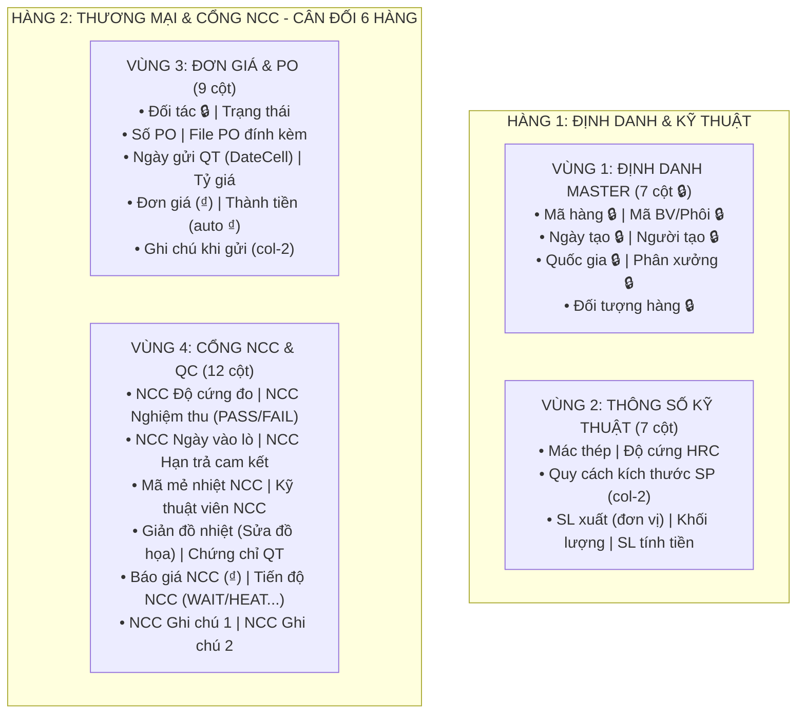

# Kế hoạch Triển khai: Nâng cấp Toàn diện Chế độ Chỉnh sửa LotDetailModal (v2.8.7)

> [!IMPORTANT]
> **Yêu cầu phê duyệt từ Người dùng**: Bản kế hoạch này đã được **kiểm toán toàn diện 100% đối chiếu với bảng Tracking** theo góp ý của bạn. Mọi cột thiếu sót (`ty_gia`, `ncc_thongtinkhac1`, `ncc_thongtinkhac2`) đã được đưa vào đúng vùng, và cột dư thừa trùng lặp (`han_tra` trùng với `ncc_ngay_tra_qt`) đã được loại bỏ. Vui lòng bấm **Proceed** hoặc xác nhận để bắt đầu viết test TDD và triển khai trực tiếp vào mã nguồn!

---

## 1. Kết quả Kiểm toán & Điều tiết 36 Cột Schema (Reconciliation Audit)

Đối chiếu trực tiếp với `ACTIVE_GRID_COLUMNS` trên bảng tracking (`src/routes/tracking.tsx`) và `ALL_COLUMN_DEFINITIONS` (`column-config-modal.tsx`), kết quả kiểm toán cụ thể như sau:

| STT | Phân Vùng Bento | Cột trên Bảng Tracking | Trạng thái trước kiểm toán | Điều tiết trong v2.8.7 |
|:---:|:---|:---|:---:|:---|
| **0** | **Header** | `ID_Key` (`id_nhiet_qt`) | ✅ Đã có ở Header badge | Giữ nguyên hiển thị mã định danh chính |
| **1-7** | **Vùng 1: Định danh Master** | `ma_hang`, `id_ma_hang`, `ngay_tao`, `nguoi_tao`, `quoc_gia`, `phong_sx`, `doi_tuong_hang` | ⚠️ `nguoi_tao` bị hở cho sửa | **Khóa 🔒 100% cả 7 Master columns** (kể cả `nguoi_tao`), không cho sửa |
| **8-14** | **Vùng 2: Kỹ thuật & Kích thước** | `vat_lieu`, `do_cung`, `kich_thuoc_sp`, `so_luong`, `don_vi_tinh`, `kg_lot`, `so_luong_tinh` | ⚠️ `so_luong_tinh` chiếm 2 cột dài thô | **Gom cụm khoa học**: Hàng 3 cột cân đối (`Số lượng xuất` + chọn đơn vị \| `Khối lượng kg` \| `SL tính tiền`) |
| **15-23** | **Vùng 3: Tiến độ & Thương mại** | `cty_qt`, `trang_thai`, `so_dat_hang`, `ten_file_dat_hang`, `ngay_gui_qt`, `don_gia`, `thanh_tien`, `ty_gia`, `ghi_chu_khi_gui` | ❌ **Thiếu `ty_gia`**<br>⚠️ **Dư `han_tra`** (trùng với `ncc_ngay_tra_qt`) | **Bổ sung `ty_gia`**, **loại bỏ `han_tra` trùng lặp**; tự động tính `Thành tiền = SL tính x Đơn giá x Tỷ giá` |
| **24-35** | **Vùng 4: Cổng NCC & QC** | `ncc_ngay_qt`, `ncc_ngay_tra_qt`, `ncc_id_lot_qt`, `ncc_name_qt`, `ncc_giando`, `ncc_ket_qua_hrc`, `ncc_ket_qua_qc`, `ncc_don_gia`, `ncc_tatus`, `ncc_thongtinkhac1`, `ncc_thongtinkhac2`, `ncc_file1` | ❌ **Thiếu `ncc_thongtinkhac1`**<br>❌ **Thiếu `ncc_thongtinkhac2`** | **Bổ sung đầy đủ cả 2 trường `NCC Ghi chú 1` và `NCC Ghi chú 2`**; đủ trọn vẹn 12 cột Vendor |

👉 **Tổng kết**: Toàn bộ **36/36 cột dữ liệu** đều được hiện diện chính xác, khoa học, không thừa - không thiếu!

---

## 2. Bố cục Bento Grid 4 Vùng Cân Xứng Tuyệt Đối



---

## 3. Chi tiết Cải tiến Kỹ thuật (Proposed Changes)

### Component 1: `src/components/tracking/date-cell.tsx`
- Bổ sung prop `variant?: 'cell' | 'input'`.
- Khi `variant === 'input'`:
  - Khung bao ngoài mang viền input: `h-6 px-1.5 text-xs font-mono rounded-xs border border-primary bg-background text-foreground flex items-center justify-between cursor-pointer shadow-2xs hover:border-primary/80`.
  - Icon `CalendarIcon` luôn hiển thị trực quan (`opacity-70 group-hover:opacity-100 text-primary`).
  - Nếu ngày rỗng, hiển thị placeholder `dd/mm/yyyy` mờ.

### Component 2: `src/components/tracking/lot-detail-modal.tsx`
1. **Khóa 100% 7 Master Identifiers**:
   - `nguoi_tao`: Bỏ ô input, hiển thị dạng read-only kèm icon `Lock size={9}` tương tự `ma_hang`, `ngay_tao`.
2. **Loại bỏ trùng lặp & Bổ sung cột thiếu**:
   - Loại bỏ trường `han_tra` khỏi Vùng 3 (đã có `ncc_ngay_tra_qt` tại Vùng 4).
   - Bổ sung `ty_gia` (Tỷ giá) vào Vùng 3.
   - Bổ sung `ncc_thongtinkhac1` (NCC Ghi chú 1) và `ncc_thongtinkhac2` (NCC Ghi chú 2) vào Vùng 4.
3. **Tự động tính Thành tiền & Tiền tệ `₫`**:
   - `thanh_tien = Math.round(Number(so_luong_tinh || 0) * Number(don_gia || 0) * Number(ty_gia || 1))`.
   - Cập nhật tự động khi thay đổi `so_luong_tinh`, `don_gia`, hoặc `ty_gia`.
   - Hiển thị ký hiệu `₫` và nhãn đọc format rõ ràng.
4. **Cân đối Bento & Thu hẹp khoảng cách**:
   - `space-y-2.5`, `gap-2.5`, padding card `p-3`.
   - Vùng 3 và Vùng 4 xếp thành các cặp 2 cột ngay ngắn, loại bỏ triệt để khoảng trống rỗng ở đáy.
5. **Cơ chế Cảnh báo Mất Dữ liệu (Unsaved Changes Guard)**:
   - Theo dõi `isDirty`: khi người dùng đã sửa mà chưa lưu:
     - Bấm `Lô trước`, `Lô sau`, `Jump`: Hiện popup cảnh báo `window.confirm(...)`.
     - Bấm `Hủy`: Xác nhận hủy bỏ thay đổi.
     - Bấm `✕` hoặc click backdrop: Chặn đóng hoặc hỏi xác nhận.
   - Chuyển nút `Đóng` thành `Hủy` ở footer khi `isEditing`; tạm vô hiệu hóa in phiếu lệnh khi chưa lưu.

---

## 4. Kế hoạch Kiểm thử & Nghiệm thu (Verification Plan)

### Kiểm thử Tự động (Automated Tests)
Chạy bộ kiểm thử Vitest toàn diện:
```bash
npm test
```
**Tiêu chí nghiệm thu**: 31/31 file test vượt qua, tối thiểu 299/299 test case passed (100% PASS), không có hồi quy.

### Kiểm thử Thủ công (Manual Verification)
1. **Kiểm tra 36 Cột**: Rà soát đầy đủ 36 cột, kiểm tra `ty_gia`, `ncc_thongtinkhac1`, `ncc_thongtinkhac2` hiển thị chuẩn.
2. **Kiểm tra DateCell**: 4 ô ngày tháng (`Ngày gửi QT`, `NCC Ngày vào lò`, `NCC Hạn trả`...) hiển thị khung input có viền và icon lịch.
3. **Kiểm tra Auto-Calc**: Nhập `SL tính tiền = 2`, `Đơn giá = 32.000` $\rightarrow$ `Thành tiền` tự nhảy `64.000 ₫`.
4. **Kiểm tra Khóa Master**: `nguoi_tao` có biểu tượng khóa 🔒 và không thể chỉnh sửa.
5. **Kiểm tra Cảnh báo**: Nhập dữ liệu dở dang $\rightarrow$ bấm nút chuyển lô $\rightarrow$ hiện hộp thoại cảnh báo.
