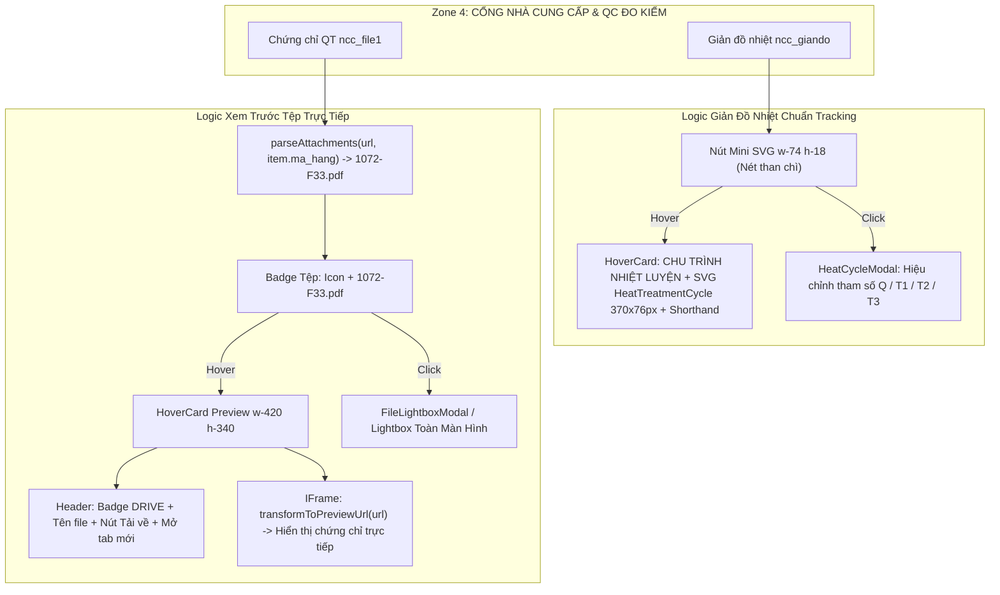

# Kế Hoạch Nâng Cấp Cửa Sổ Xem Trước Giản Đồ Nhiệt & Xem Nhanh Chứng Chỉ QT (v2.8.5)

> **Design Read**: Industrial MES floating modal redesign for manufacturing dispatchers and QC engineers, with a cool graphite wireframe Bento Grid language, leaning toward Dynamo MES Specification v2.7.0 (compact 2px rounded sub-elements, monospaced tabular nums, high density, and quick hover-preview inspectability).

---

## 1. Mục Tiêu & Vấn Đề Cần Giải Quyết (Goal Description)

Dựa trên phản hồi thực tế và 5 hình ảnh người dùng cung cấp:
1. **Lỗi hiển thị Giản đồ nhiệt (`ncc_giando`)**:
   - *Hiện trạng (Hình 2)*: Đang bị hàm `parseAttachments` phân tích sai chuỗi chu trình nhiệt (VD: `"Q: 1020°C / 2H | T1: 540°C / 5H | T2: 593°C / 5H"`) thành tệp tin có tên khó hiểu `"5H"`, khi hover chỉ hiện ô văn bản thay vì biểu đồ chu trình nhiệt luyện SVG.
   - *Mục tiêu (Hình 1)*: Chuyển đổi thuộc tính hiển thị giống 100% cột Giản đồ trên bảng Tracking: render nút đồ họa mini SVG nét than chì (`w-[74px] h-[18px]`), khi hover bung cửa sổ nổi `HoverCard` mang tiêu đề **"CHU TRÌNH NHIỆT LUYỆN"**, mã hàng `lotCode` và biểu đồ SVG to chi tiết `HeatTreatmentCycle` (`370x76px`). Khi click chuột thì mở `HeatCycleModal` để xem/hiệu chỉnh.
2. **Đồng bộ tên file Chứng chỉ QT (`ncc_file1`) & Xem trước trực tiếp (Hình 3, 4, 5)**:
   - *Hiện trạng (Hình 3)*: Tên file đang hiển thị mã kỹ thuật `GoogleDrive_11UWspWr.pdf` thay vì tên file người dùng đã lưu/đổi là `1072-F33.pdf` (Hình 4); khi hover chỉ hiện ô link URL text trơ trụi mà không thấy nội dung tài liệu.
   - *Mục tiêu (Hình 5)*:
     - Tự động đồng bộ tên file theo Mã hàng của lô: truyền `defaultPrefix={item.ma_hang || item.id_ma_hang}` để hiển thị chuẩn xác `1072-F33.pdf`.
     - Nâng cấp cửa sổ HoverCard xem trước (kích thước chuẩn `w-[420px] h-[340px]`): Nhúng trực tiếp `iframe` với `transformToPreviewUrl(url)` để xem trước toàn bộ trang biên bản nhiệt luyện (`熱処理検査表 HEAT TREATMENT CERTIFICATE`), kèm thanh header chuẩn có badge `DRIVE`, nút `Tải về`, nút `Mở tab mới ↗` và nút `Phóng to ⛶`.

---

## 2. Kiến Trúc Kỹ Thuật (Architecture & Component Design)



---

## 3. Chi Tiết Kỹ Thuật Đổi Mới

### A. Tích Hợp Giản Đồ Nhiệt Chuẩn Bảng Tracking
- Thay vì chuyển `item.ncc_giando` vào `AttachmentHoverPreview`:
  - Kiểm tra nếu `item.ncc_giando` mang định dạng chu trình nhiệt (hoặc có giá trị chu trình nhiệt `Q:...` / `.../2H` hoặc chuỗi text ngắn):
    - Render trực tiếp component `HoverCard` với nút mini SVG `HeatTreatmentCycle variant="mini" width={74} height={18}` giống hệt `AttachmentCell` ở dòng 573-626 trong `src/components/tracking/attachment-field.tsx`.
    - Khi hover: Bung cửa sổ `HoverCardContent` (rộng 400px) hiển thị tiêu đề `CHU TRÌNH NHIỆT LUYỆN`, `lotCode` (`1072-F33`), component `HeatTreatmentCycle` kích thước lớn (`width={370} height={76} showFrame={true}`) và dòng thông số chi tiết.
    - Khi click: Mở `HeatCycleModal` để dispatcher hoặc QC xưởng xem và hiệu chỉnh nhiệt độ / thời gian nung tôi, ram.
  - Nếu chưa có dữ liệu: Hiển thị nút `+ Giản đồ` để nạp nhanh thông số chu trình.

### B. Đồng Bộ Tên File và Nhúng Iframe Xem Trước Trực Tiếp
- **Đồng bộ tên file**:
  - Khi gọi `parseAttachments(rawUrl, item.ma_hang || item.id_ma_hang)`:
    - `extractFileName` nhận `defaultPrefix = '1072-F33'`.
    - Link Google Drive tự động trả về `1072-F33.pdf` thay vì `GoogleDrive_11UWspWr.pdf` (khắc phục triệt để lỗi ở Hình 3 và khớp với Hình 4).
- **Cửa sổ HoverCard Xem Trước Nhúng Iframe (Hình 5)**:
  - Nâng cấp `AttachmentHoverPreview`:
    - Sử dụng `HoverCard` với `openDelay={120}` và `closeDelay={100}`.
    - Cửa sổ nổi rộng `w-[420px]` với phần thân cao `h-[270px]`.
    - Phần Header:
      - Badge định danh đám mây (`renderFileTypeBadge(type, source)`: `DRIVE` / `CLOUD` / `PDF`).
      - Tên file sắc nét: `1072-F33.pdf`.
      - Nút hành động: `Tải về` (nút icon Download tải trực tiếp), `Mở tab mới ↗` (mở liên kết gốc), `Phóng to ⛶` (kích hoạt Lightbox toàn màn hình).
    - Phần Body:
      - Nhúng `iframe` tải `src={transformToPreviewUrl(it.url)}` với class `w-full h-full rounded border border-border/60 bg-white`.
      - Tự động hiển thị văn bản chứng chỉ PDF / Google Drive y như Hình 5!
      - Đối với file ảnh: Render thẻ `` với `object-contain max-h-[260px]`.

---

## 4. Danh Sách Tệp Thay Đổi (Proposed Changes)

### Component Area

#### [MODIFY] `src/components/tracking/lot-detail-modal.tsx`
- Import `HeatTreatmentCycle` và `HeatCycleModal` từ `@/components/technical-charts`.
- Thêm state `heatCycleModalOpen` để mở modal hiệu chỉnh chu trình nhiệt luyện khi click vào Giản đồ nhiệt.
- Cập nhật hiển thị ô **Giản đồ nhiệt** trong Zone 4:
  - Nếu có giá trị: Render nút mini SVG nét than chì + HoverCard bung biểu đồ SVG to chi tiết (Hình 1).
  - Click mở `HeatCycleModal`.
- Nâng cấp component `AttachmentHoverPreview`:
  - Nhận thêm prop `lotCode={item.ma_hang || item.id_ma_hang}` để truyền vào `parseAttachments`, đồng bộ tên file `1072-F33.pdf`.
  - Thay thế khung placeholder tĩnh bằng `iframe` nhúng preview tài liệu thực tế với `transformToPreviewUrl(url)` (Hình 5).
  - Bổ sung nút `Tải về`, `Mở tab mới`, và `Phóng to`.

#### [MODIFY] `src/test/lot-detail-modal-floating-window.test.ts`
- Cập nhật unit test suite:
  - TC-LDM-09: Kiểm tra Giản đồ nhiệt tích hợp `HeatTreatmentCycle` mini SVG và HoverCard `CHU TRÌNH NHIỆT LUYỆN` giống bảng Tracking.
  - TC-LDM-10: Kiểm tra tên file tệp đính kèm tự động đồng bộ theo `lotCode` (`ma_hang.pdf`).
  - TC-LDM-11: Kiểm tra cửa sổ xem trước HoverCard nhúng `iframe` xem trước tài liệu và nút Tải về/Mở tab mới.

---

## 5. Kế Hoạch Kiểm Thử & Nghiệm Thu (Verification Plan)

### Automated Test Suite
Chạy toàn bộ test suites của hệ thống:
```bash
npm test -- src/test/lot-detail-modal-floating-window.test.ts src/test/design-system-compliance.test.ts src/test/app-routing.test.tsx src/test/attachment-and-date-fields.test.ts
```

### Manual Verification
1. Mở trang `/tracking`, nhấp vào mã hàng `1072-F33`.
2. Quan sát ô **Giản đồ nhiệt** trong Zone 4:
   - Thấy nút mini SVG vector nét than chì (không còn chữ "5H" lạ lẫm).
   - Rê chuột vào: HoverCard bung ra hiển thị tiêu đề `CHU TRÌNH NHIỆT LUYỆN` kèm biểu đồ chu trình nhiệt SVG 370x76px (chuẩn như Hình 1).
   - Nhấp chuột: Modal hiệu chỉnh thông số nhiệt `HeatCycleModal` mở ra sẵn sàng.
3. Quan sát ô **Chứng chỉ QT (CO/CQ)** trong Zone 4:
   - Tên file hiển thị chuẩn `1072-F33.pdf` (khớp với Hình 4).
   - Rê chuột vào badge: Cửa sổ HoverCard nổi lên (rộng ~420px) tải iframe trực tiếp văn bản chứng chỉ PDF (như Hình 5).
   - Bấm nút "Mở tab mới" hoặc "Phóng to" để kiểm tra tính năng mở rộng.
