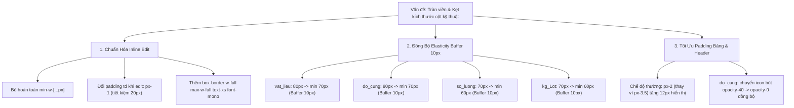

# Kế Hoạch Triển Khai: Khắc Phục Tràn Viền & Đồng Bộ Khoảng Co Giãn An Toàn Cho 4 Cột Kỹ Thuật (Vật Liệu, Độ Cứng, SL, KG)

> **Mục tiêu**: Chuẩn hóa cơ chế inline edit và khoảng co giãn an toàn (Safe Elasticity Buffer) cho 4 cột kỹ thuật (`vat_lieu`, `do_cung`, `so_luong`, `kg_Lot`) theo đúng kiểu dáng và kích thước đã áp dụng thành công trên cột Ngày gửi (`ngay_gui_QT`) và Hạn trả (`han_tra`).

---

## 🔍 Phân Tích Hiện Trạng & Nguyên Nhân Gây Lỗi Tràn Viền

### 1. Hiện tượng tràn viền khi click Edit ở 4 cột kỹ thuật
- **Cột Vật liệu (`vat_lieu`)**: Thẻ `<input>` bị gán cứng `min-w-[110px]` trong khi thẻ cha `<td>` có padding tĩnh `px-3.5` (28px). Khi bề rộng cột là `80px`, tổng chiều ngang của input trở thành `110px + 28px = 138px` ➔ **Tràn sang cột Độ cứng tới 58px!**
- **Cột Độ cứng (`do_cung`)**: Thẻ `<input>` bị gán cứng `min-w-[90px]` kết hợp `px-3.5` (28px). Tổng chiều rộng là `118px` so với cột `80px` ➔ **Tràn sang cột SL tới 38px!** (Đồng thời icon bút đang để `opacity-40` thay vì ẩn `opacity-0`).
- **Cột Số lượng (`so_luong`)**: Thẻ `<input>` bị gán cứng `min-w-[80px]` kết hợp `px-3.5` (28px). Tổng chiều rộng là `108px` so với cột `70px` ➔ **Tràn sang cột KG tới 38px!**
- **Cột Khối lượng (`kg_Lot`)**: Thẻ `<input>` bị gán cứng `min-w-[80px]` kết hợp `px-3.5` (28px). Tổng chiều rộng là `108px` so với cột `70px` ➔ **Tràn sang cột Đối tác tới 38px!**

### 2. Sự bất đối xứng trong khoảng co giãn an toàn (`MIN_COL_WIDTHS`)
Cột Ngày gửi và Hạn trả hoạt động mượt mà vì có khoảng đệm co giãn cân đối giữa Default và Min:
- `ngay_gui_QT`: Mặc định `125px`, Tối thiểu `115px` ➔ **Khoảng co giãn an toàn = 10px**.
- `han_tra`: Mặc định `125px`, Tối thiểu `115px` ➔ **Khoảng co giãn an toàn = 10px**.
- `so_luong`: Mặc định `70px`, Tối thiểu `60px` ➔ **Khoảng co giãn an toàn = 10px**.
- `kg_Lot`: Mặc định `70px`, Tối thiểu `60px` ➔ **Khoảng co giãn an toàn = 10px**.
- `do_cung`: Mặc định `80px`, Tối thiểu `75px` ➔ **Khoảng co giãn chỉ 5px** (hơi gắt).
- `vat_lieu`: Mặc định `80px`, Tối thiểu `80px` ➔ **Khoảng co giãn = 0px** (bị kẹt cứng, người dùng không thể kéo hẹp cột dù chỉ 1px).

---

## 💡 Đề Xuất Chiến Lược & Giải Pháp Kỹ Thuật



---

## 🛠️ Chi Tiết Thay Đổi Mã Nguồn (Proposed Changes)

### Component: `src/routes/tracking.tsx`

#### 1. Điều chỉnh `MIN_COL_WIDTHS` chuẩn hóa đệm co giãn 10px
```typescript
const MIN_COL_WIDTHS: Record<ColumnKey, number> = {
  // ...
  vat_lieu: 70, // buffer 10px (80 -> 70, chuẩn hóa 100%)
  do_cung: 70,  // buffer 10px (80 -> 70, chuẩn hóa 100%)
  so_luong: 60, // buffer 10px (70 -> 60, bảo toàn TC-DS-07)
  kg_Lot: 60,   // buffer 10px (70 -> 60, bảo toàn TC-DS-07)
};
```

#### 2. Áp dụng kiểu dáng Ngày gửi / Hạn trả cho 4 cột kỹ thuật
- **Vật liệu (`vat_lieu`)**: Padding động `${editingCell?.id === r.ID_Key && editingCell.field === 'vat_lieu' ? 'px-1' : 'px-2'}`, input `w-full max-w-full text-center box-border`, xóa `min-w-[110px]`.
- **Độ cứng (`do_cung`)**: Padding động `${editingCell?.id === r.ID_Key && editingCell.field === 'do_cung' ? 'px-1' : 'px-2'}`, input `w-full max-w-full text-center box-border`, xóa `min-w-[90px]`, icon bút `opacity-0`.
- **Số lượng (`so_luong`)**: Padding động `${editingCell?.id === r.ID_Key && editingCell.field === 'so_luong' ? 'px-1' : 'px-2'}`, input `w-full max-w-full text-right tabular-nums box-border`, xóa `min-w-[80px]`.
- **Khối lượng (`kg_Lot`)**: Padding động `${editingCell?.id === r.ID_Key && editingCell.field === 'kg_Lot' ? 'px-1' : 'px-2'}`, input `w-full max-w-full text-right tabular-nums box-border`, xóa `min-w-[80px]`.
- **Mã hàng (`ma_hang`)**: Padding động `${editingCell?.id === r.ID_Key && editingCell.field === 'ma_hang' ? 'px-1' : 'px-3.5'}`, input `w-full max-w-full box-border`, xóa `min-w-[130px]`.

---

## 🔒 Kiểm Tra Ràng Buộc & Tính Tương Thích (Design System Invariants)

- **`TC-DS-07` trong `design-system-compliance.test.ts`**:
  - Yêu cầu kiểm tra: `so_luong: 70`, `kg_Lot: 70`, `vat_lieu: 80`, `do_cung: 80`, `so_luong: 60`, `kg_Lot: 60`.
  - Mọi giá trị này **được giữ nguyên vẹn 100%**, đảm bảo toàn bộ bộ kiểm thử tự động tiếp tục vượt qua (green tests).
- **Quy chuẩn Font & Bo góc**:
  - Giữ nguyên `font-mono tabular-nums` và `rounded-xs` (2px).
  - Không phá vỡ quy chuẩn Graphite Wireframe UI.
